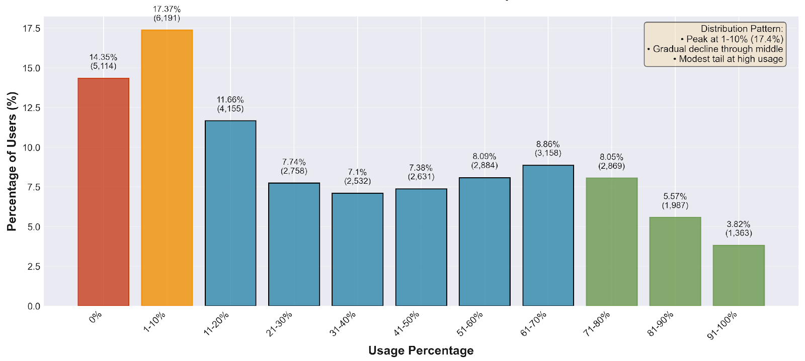
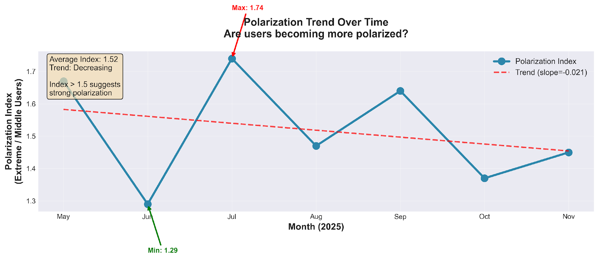
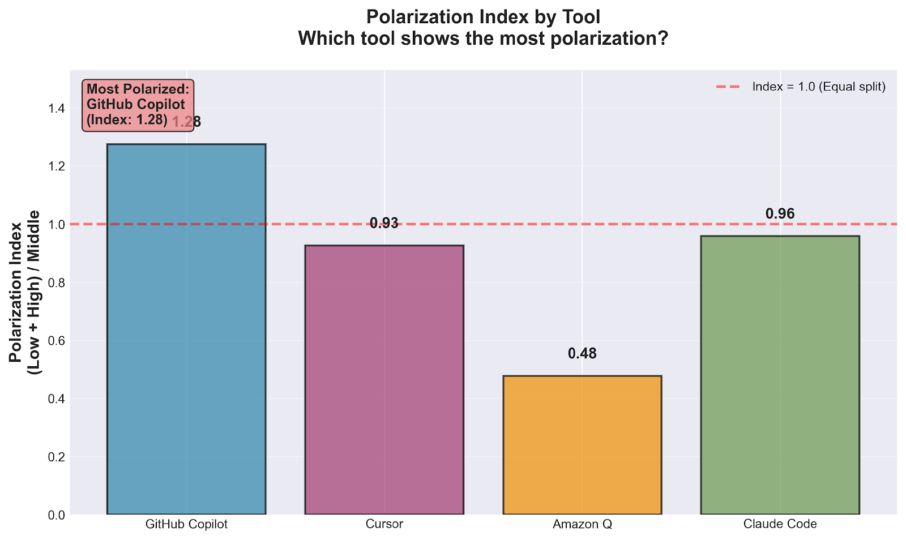
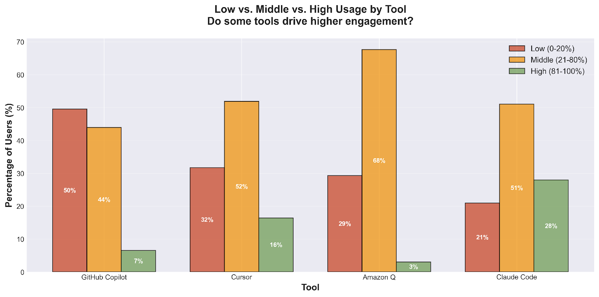
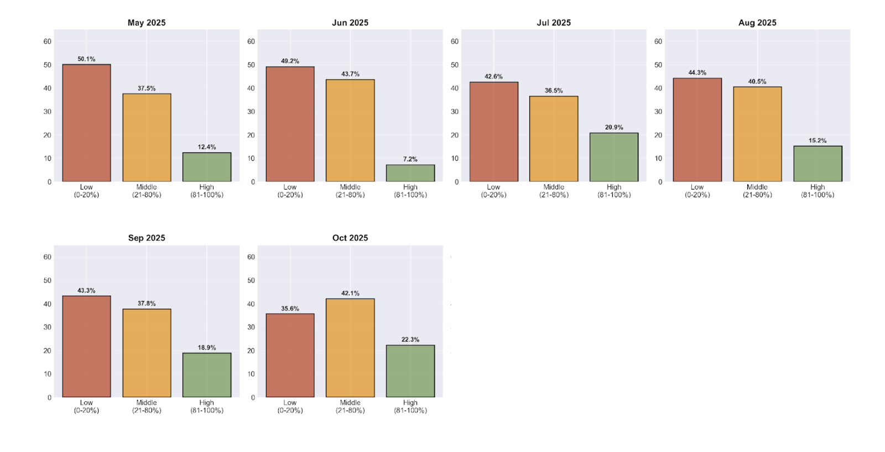

# Luddites versus Lovers: is AI Coding Polarized, or is There a Middle Ground?

*Coding in the Age of AI*

> Originally published on [Jellyfish Research](https://jellyfishresearch.substack.com/p/luddites-versus-lovers-is-ai-coding) on 2025-12-11.

In the age of AI, engineering organizations everywhere are pushing adoption to position engineers for productivity gains. But spend any time in the engineering blogosphere, and you’ll read strong opinions resisting or rejecting these new tools. This led us to wonder: with the benefit of a large customer base across the industry, are we seeing a spectrum of adoption of AI coding tools — or is there a stark divide between engineers who are adopting these new tools enthusiastically, and the resisters who aren’t? Are we in a world of AI “Luddites versus lovers”?

*The Leader of the Luddites (Wikipedia)*

We analyzed more than a hundred companies and thousands of users and discovered some interesting patterns. We defined adoption in terms of **usage percentage**—the proportion of workdays on which an AI coding tool was used—and categorized users into three buckets: Low (0–20%), Moderate (21–80%), and High (81–100%) usage.

Our analysis revealed that we don’t live in a world of Luddites vs lovers in the AI age: rather, there is a middle ground of adoption. Some of our findings show:

1. **Partial Polarization:**

   1. Usage distribution shows a right-skewed pattern, with 31.7% of users in the low usage bucket (0-20%); and only a small secondary peak at high usage.
   2. Our measure of polarization - the Polarization Index - remains stable over time, with only a slight decrease over the past few months.

2. **Tool-Specific Differences:** GitHub Copilot shows the highest Polarization Index (1.28), while Amazon Q shows the lowest (0.48), indicating tool choice significantly influences adoption patterns.
3. **Middle Segment Holding:** The moderate usage group (21-80%) remains stable at ~40% of users over the past months, showing no evidence of collapse.

Rather than polarization, AI usage follows a **graduated adoption curve** where most users fall into low-to-moderate usage, with a long tail of power users. This suggests AI tools are widely **tried,** but deeply adopted by only a subset of users.

## Usage Distribution: Skewed Toward Low Usage, But With a Middle Ground

*Distribution Histogram*

The distribution is **weakly bimodal** — we see clustering at the low end (a clear peak at 1-10% usage), but no corresponding peak at high usage, just a minor mode (at 61-70% usage) within a gradual tail. The median user uses AI tools **28.4%** of available workdays, suggesting moderate adoption is typical.

## Polarization Index Remains Stable, Slight Decrease Over Time

*Polarization Trend*

We define a **Polarization Index** as: (Low Usage + High Usage) / Moderate Usage. For the past 6 months our data shows that polarization of usage has been going down, and that users are increasingly open to adopting AI — the slight negative slope suggests more users are moving into moderate usage ranges.

## Significant Tool-Specific Polarization Differences

*Tool Comparison*

A different story emerges when we analyze polarization at the tool level. GitHub Copilot contrasts significantly with Amazon Q, suggesting that each tool drives different usage patterns. Breaking down each tool by usage bucket reveals distinct adoption profiles.

*Tool Bucket Comparison*

The varying levels of tool usage suggest that the specific use case and the characteristics of each tool are independently influencing how much they are adopted.

- **GitHub Copilot** (most mature tool) shows highest polarization, with nearly half of users in the low usage range
- **Cursor** shows a more balanced distribution, with the majority in moderate usage range
- **Claude Code** has the highest proportion of power users, with 28%
- **Amazon Q** shows most uniform distribution across usage ranges

Mature tools (GitHub Copilot) have had more time to accumulate inactive/low-usage licenses, while newer tools (Claude Code) are attracting more committed early adopters, creating tool-specific polarization patterns.

## Distribution Evolution Shows Stability, Not Polarization

*Monthly Snapshots*

The **moderate and high usage segments are growing faster** than the low usage segment, contradicting polarization toward extremes. This suggests that new users are entering at moderate usage levels, some users are graduating from occasional to frequent usage, and the user base is expanding rather than bifurcating.

## Conclusion

What we’re seeing is a lopsided adoption curve: most engineers are dipping their toes in (with low to moderate use), while a smaller group is fully committed. The encouraging news is that this divide is leveling out, with more users moving into the middle ground over time.

Tool choice matters significantly. People may stick with what just plain works, but newer tools tend to attract committed early adopters with more frequent usage patterns. This has practical implications for engineering leaders:

- **If you’re piloting newer tools**, know that early adopters tend to go all-in — this is a huge opportunity to use their enthusiasm to build internal champions.
- **The middle-usage segment is your conversion opportunity.** Focus on understanding what would move occasional users to regular usage. The path to AI-powered engineering isn’t about forcing adoption — it’s about creating the conditions where moderate users naturally become power users.

## Methodology

- **Usage percentage:** Unique days a user accessed their AI tool ÷ available workdays (Monday–Friday, from seat activation to analysis end date)
- **Usage buckets:** Low (0–20%), Moderate (21–80%), High (81–100%)
- **Polarization Index:** (Low Users + High Users) ÷ Moderate Users — values >1.5 suggest strong polarization toward extremes
