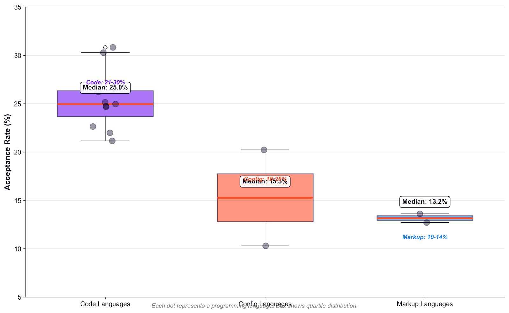
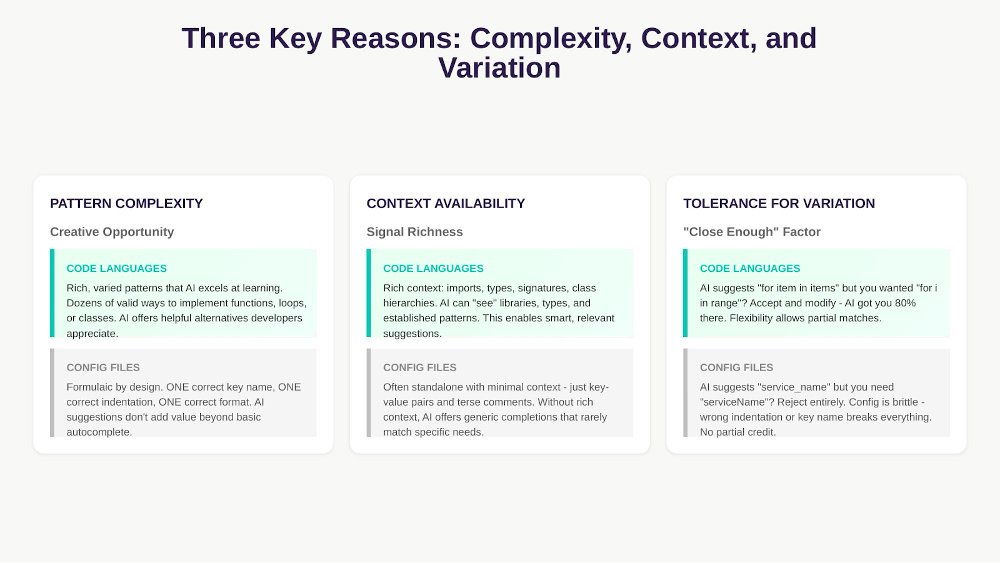
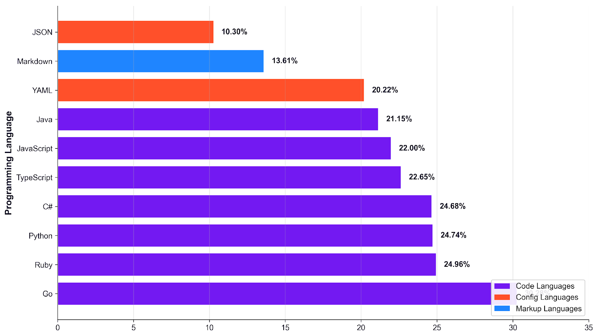
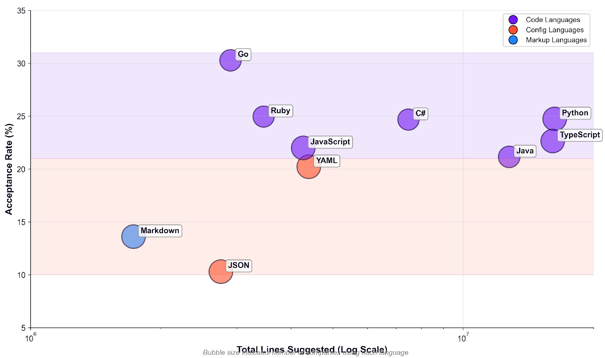

# Measuring ROI in AI era: The language effect

*An analysis on AI ROI, acceptance rate and programing languages*

> Originally published on [Jellyfish Research](https://jellyfishresearch.substack.com/p/measuring-roi-in-ai-era-the-language) on 2026-01-23.

### Overview

*An emerging question is the return on investment (ROI) for AI and how should companies analyze it. Particularly we focused on how the nature of the programming language used significantly influence the acceptance rate and, consequently, the ROI?*

*We analyzed 750+ million lines of AI-suggested code across companies using multiple AI coding tools and discovered that programming language **choice affects the AI ROI**.*

### Introduction

Every three-six months, a new LLM record is shattered on a public leaderboard, yet for the average developer, the “revolutionary” shift rarely feels reflected in the daily git commit. This was true until Anthropic released Opus 4.5 and suddenly the impact was a “before-after” Opus 4.5 era, code started to go at another quality and speed level.

But here’s the question that experience raises: *how do you actually measure that impact?*

While industry benchmarks focus on capabilities like quality, performance and safety, they often miss the metrics that truly matter to a business: productivity gains or value generated.

Quantifying the value derived from lines of code is inherently complex, subjective, and prone to disagreement. Ultimately, value is a business-level concept, tied directly to the organization’s mission and assessed through core business metrics. However, we can use the adoption of generated “tokens” as a proxy for value creation. If an AI tool produces valuable output, its tokens are adopted; if not, they are rejected. By measuring the ratio of accepted to rejected tokens within our codebase, we could gain a clearer perspective on the value (or at least the productivity) generated by using AI, and consequently a *proxy* of its ROI.

In this piece, we will measure acceptance rate not with tokens, but rather with lines of code. If tokens are the new “currency” of AI, then acceptance rate(lines accepted/lines generated) is the *exchange rate* that tells you what that currency is actually worth in the real world.

### Main Findings

Our analysis revealed a clear and consistent pattern across the industry:

- **The Language Gap is Real:** Acceptance rates for code generated by **code** **languages** like Go, Python, and Ruby are significantly higher, achieving **22–30%**, compared to **configuration** languages such as JSON and YAML, which see only **10–20% acceptance**. This represents a persistent **2–3x performance difference** across all companies.
- **Language Type Predicts Success:** **Go** is the most accepted language among the options, leading with a **30.28%** acceptance rate across 121 companies. Python, despite having a high volume of suggestions (**16.2M lines**), has a **24.74%** acceptance rate. JSON trails significantly, with only a **10.30%** acceptance rate across 151 companies.
- **Volume Doesn’t Explain It:** There is no correlation between languages acceptance rate and volume of code generated - quantity of lines of code generated does not affect accepted lines.

### Coding Language: The most valuable language per output

When we group languages by category: Code,Config and Markup the separation becomes clear: Coding leads the value generated in contrast to markups. Comparing the medians between coding vs markup languages we see almost a 2x between these two. We think the reason why this gap exist is because of three characteristics innate of each language: **Complexity, Context and Variation**

- **Code languages:** Median ~24%, range 21-30%
- **Config languages:** Median ~15%, range 10-20%
- **Markup languages:** Median ~13%, range 10-14%

*Language Categories Distribution*

## Complexity, Context and Variation

Languages that have diverse patterns, flexibility and rich signals like coding languages tend to thrive in LLM environments, in contrast to config files that are rigid and limited - below some examples of differences between languages:

*AI offers high acceptance rate in code languages (like Python, Go, TypeScript, Java) due to their complexity, varied patterns, and rich contextual information (imports, types, hierarchies). This allows AI to provide genuinely helpful alternatives and completions.*

*Conversely, acceptance rate is lower in formulaic configuration languages (like JSON, YAML). These have low pattern complexity, require one correct format, and are often context-poor (standalone key-value pairs). Since these formats are brittle, developers reject “close enough” suggestions, limiting AI’s value beyond basic autocomplete.*

## Language Matters More Than You Think: Top 10 is predominantly code language

Across 750+ million lines of AI-suggested code from multiple AI coding tools, we found a clear hierarchy. Traditional programming languages consistently achieve 2-3x higher acceptance rates than configuration and markup languages. **The top ten acceptance rates by languages show how this is predominantly led by code language.** If your team writes primarily config files, even the best AI tool will show “disappointing” overall numbers. That’s not a tool failure, it’s the “language effect” in action with Go having the highest acceptance rate.

*Language Acceptance Rates(%)*

### Volume vs Acceptance: No Correlation

One question that we wanted to validate is: *“Is the volume of code generated affecting the quality of tokens generated ?”* The answer seems *no, volume doesn’t predict acceptance*. Python (most widely used) and Go (mid-volume) both achieve high acceptance rates because they’re code languages. JSON (high volume) and Markdown (low volume) both struggle because they’re configuration/markup formats.

If volume mattered, we’d see a diagonal trend. Instead, we see horizontal clustering by language type. This might be because acceptance rate is more closely related to the performance of the actual LLM in the different context engineering environments and its conditions. Although LLMs tend to experience degradation over time depending on the context length and task difficulty the correlation with language vs volume disappears.

*Volume vs Acceptance*

## Practical Implications: What This Means for Your Team

### Measuring ROI

- **Measure Time Saved, Not Just Cost:** Track the duration of content creation and review cycles pre- and post AI.(Jellyfish [AI Impact](https://jellyfish.co/platform/jellyfish-ai-impact/) tracks this for you !)
- **Convert Accepted Lines into Financial Value:** Measure acceptance rate of tokens and calculate ROI using the following function:

  **ROI** = [(Acceptance Rate × Total Tokens × Time Saved per Token × Dev Cost) - AI Cost] / AI Cost

## Conclusion

Programming language choice has a **larger impact** on AI code acceptance rates than which AI tool you use. Our analysis of **750+ million lines** across **239+ companies** and **multiple AI coding tools** shows that traditional programming languages (Go, Python, Ruby, TypeScript) achieve **22-30%** acceptance rates, while configuration and markup formats (JSON, YAML, Markdown) achieve **10-20%** - a consistent **2-3x difference**.

Before you analyze your AI coding assistant for low ROI, check your token efficiency and how language distribution affects the ROI.Before you switch tools, measure acceptance rates by language category. Before you set team targets, adjust expectations based on what languages your team actually writes.

## Methodology

**Data Source:** Jellyfish AI Coding Assistant Usage Analytics

**Time Period:** Jan 2025 - December 2025

**Coverage:** **750+ million lines** suggested across multiple AI coding tools

**Analysis Approach:**

- Language analysis aggregated across all tools to identify universal patterns
- Acceptance rate = (lines accepted / lines suggested) × 100
- Categories defined by language purpose: Code, Config, Markup

**Key Metrics:**

- Acceptance rate by language (aggregated across all tools)
- Total lines suggested per language
- Company adoption breadth per language - Category-level distributions
