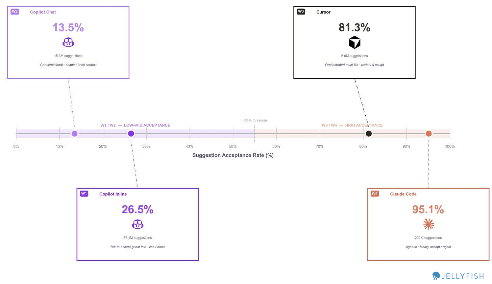
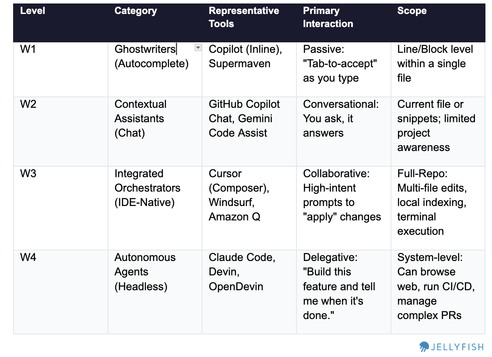
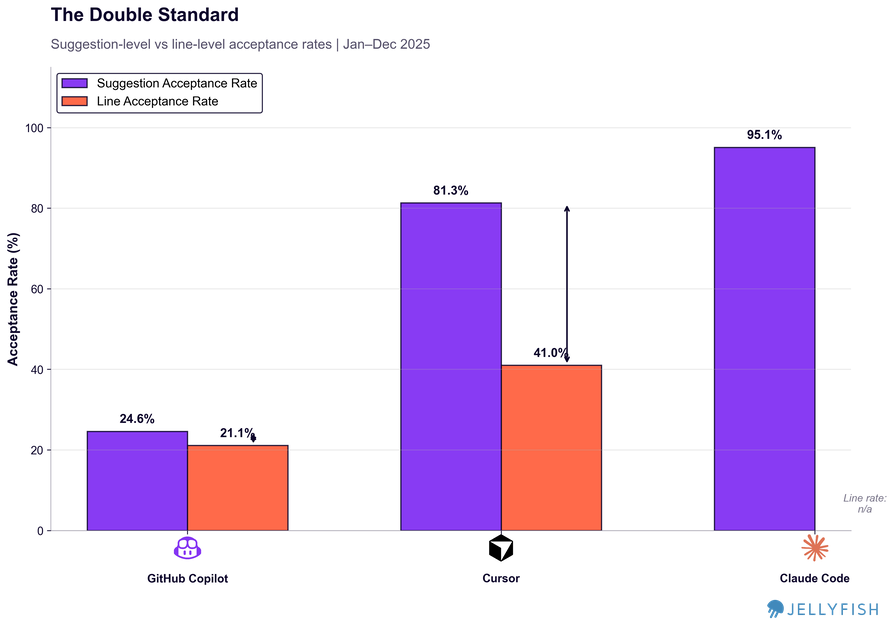
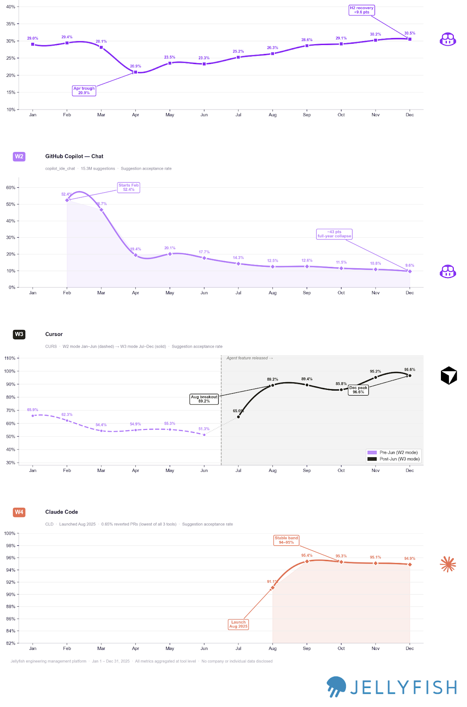
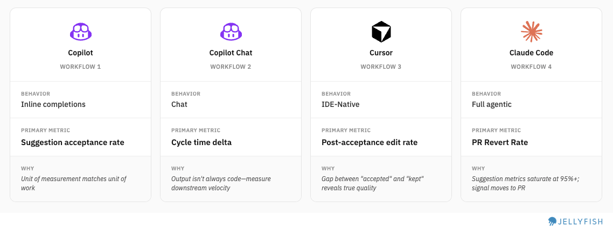
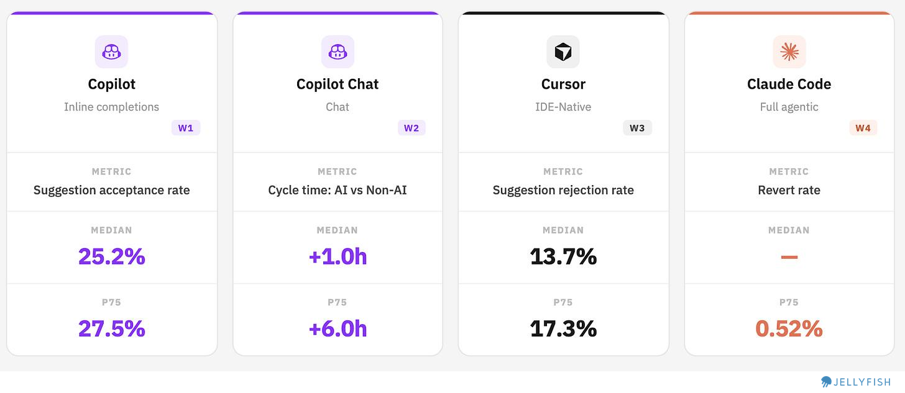
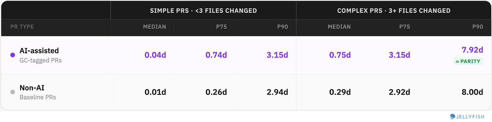

# Measuring Agentic Workflows

*A framework to understand what and how agents work and how the new workflows are evolving*

> Originally published on [Jellyfish Research](https://jellyfishresearch.substack.com/p/measuring-agentic-workflows) on 2026-02-20.

*As AI coding tools mature, some questions are rising about AI usage: How my team is using agents differently and what the workflow looks like ? How should we measure the different agents and workflows?*

We analyzed usage from three AI coding tools across our customer base throughout 2025 — GitHub Copilot, Cursor, and Claude Code — and asked: what does each tool actually do, how should we measure, and what would a fair comparison look like?

### **What We Measured and How**

Our dataset covers 90M suggestions from January through December 2025, aggregated through the Jellyfish platform from vendor APIs. For each tool, we tracked **suggestion acceptance rate, line acceptance rate, lines per suggestion, and lines per acceptance**.

We then categorized each tool to a different group that reflects how engineers are using these new tools and new workflows emerging.

### **A Framework for Understanding AI Coding agents**

We started by analyzing and comparing suggestion acceptance rates, and immediately saw that each tool sits at a **different point on the spectrum**. On one end is the full agentic experience of Claude Code; on the other are GitHub Copilot’s inline completions and Chat at lower to mid acceptance rates. This tells us something important: each tool is being used in a fundamentally different way, for a different purpose, at a different level of trust.

We use suggestion acceptance rate (%) to position each tool and define four distinct workflow tiers:

*We drew some distinctions within each product to compare fairly, within the limits of our data taxonomy. For example, GitHub Copilot spans W1 and W2. Cursor operates at W3. Claude Code operates at W4.*

## **Comparing normalized suggestions**

### **What Is a “Suggestion”?**

Suggestion is defined different across tools:

- **Copilot/Cursor**: How often users Tab-accept the inline ghost completions or block of code.
- **Claude Code**: How often users approve the proposed file changes or commands

Since we identified four different workflows, we wanted to understand whether this behavioral difference was reflected in both suggestion acceptance and line acceptance rates:

# **Findings**

Normalizing by lines rather than suggestions exposes something important about how each workflow actually works.

1. **Copilot completions:** A 5-point gap between suggestion rate and line rate. The units are small enough that partial acceptance rarely makes sense — what gets accepted, stays.
2. **Cursor:** A 40-point gap. Developers accept 4 out of 5 Cursor suggestions — but then keep only about half the lines. The real work happens after acceptance: reviewing the diff, editing what doesn’t fit, deleting what was wrong. Cursor’s 81% suggestion rate describes the starting point of a review process, not the end of one. We also think that user when using the IDE have a workflow of reviewing the code and rejecting lines because the review is part of the process. Since Cursor uses multiple models there is a follow up question: *Could it be that some models are affecting the output more than others?* Maybe
3. **Claude Code:** Line acceptance rate can’t be calculated from available data, but the workflow is inherently binary. When you accept Claude Code output you’re taking an entire implementation — there’s no line-by-line diff to partially approve. Developers either trust the result and move forward, or reject it and iterate. This workflow makes sense, it’s the type of continuous agent workflow that developers work with a forward mindset - instead of reviewing and deleting what doesn’t work the user accepts most of the code in blocks, checks if it’s functional and re-accepts another code of block to fix bugs.

# **Trends: How are workflows evolving ?**

We can see how the trend and evolution of acceptance rates can show us how each workflow evolved in the market.

In May–June 2025, [Cursor released its 1.0 experience](https://cursor.com/changelog/page/4) with significant enhancements including “background agent” and “tool search enhancement.” This was a pivotal moment: acceptance rates spiked and the tool shifted firmly into W3 (IDE-Native), moving away from the chat-heavy W2 experience that had characterized earlier usage. Once Cursor stabilized above 90% acceptance, that metric essentially lost signal.

On the other side, Copilot Chat started 2025 around 50% acceptance and stabilized at 10–20% — a substantial drop. We think this reflects a shift in how teams are using it: less for direct code generation, more as a contextual thinking tool. Chat becomes a way to understand a problem or explore an approach before actually building, not a way to ship lines. An open question worth following: *did users migrate from using W2 alone, or did they converge on a combined W2 (understanding) + W3 (building) workflow?* Something for future research.

This suggests two things:

**a)** Tools are evolving quickly on their *core* use case — not their peripheral features.

**b)** Knowing which workflow a tool occupies — and when that changes — is critical for measurement. After Cursor’s 1.0 release, it moved firmly into W3 territory, which means acceptance rate no longer has much signal. The right metric to reach for shifts to how developers are editing the code the IDE generates.

Now that we understand how each workflow behaves, we can find the metrics that actually correlate with quality in each one.

# **One Metric per Workflow**

To find the right metric for each workflow, it helps to invert the question: **how do we know when a team is using a workflow poorly?**

- For **Claude Code (W4)**, frequent interruptions signal that teams aren’t letting the agent run — which undermines the core value of full agentic output.
- For **Cursor (W3)**, heavy post-acceptance editing means suggestions aren’t landing well, often due to insufficient context engineering in the repo.
- For **Copilot Chat (W2)**, if the chat isn’t providing useful answers, engineers switch to other sources and the workflow breaks down.
- For **Copilot Inline (W1)**, a flat or low acceptance rate tells you directly whether suggestions match the patterns engineers actually want to keep.

*Each metric is designed to detect process breakdowns — so we can surface signals about where the workflow is working and where it isn’t.*

**Industry Benchmarks:**

Comparing AI tool performance across companies is genuinely difficult — especially given how fast these tools are evolving and how differently teams use them. Still, looking at benchmark ranges helps teams understand where they stand and calibrate their expectations.

We decided to explore how it looks like and see if we find interesting points to consider when using this framework:

#### Copilot improving, Cursor with a healthy rejection rate, Claude Code with near-zero revert rates

- **Copilot Inline:** Approximately 3 out 4 suggestions are still rejected, but we are seeing how this numbers are improving for the past 6 months. Even among top users, acceptance peaks below 28%, suggesting there’s still room to improve suggestion fit.
- **Copilot Chat:** Counter-intuitively, most teams using Chat are moving *slower*, not faster. Our hypothesis is that teams are reaching for Chat on harder, more ambiguous problems — which increases cycle time by design. This makes Chat’s value harder to see in throughput metrics, but that doesn’t mean it’s absent. *(See below for detail.)*
- **Cursor:** Median rejection rate of 13.7%. A lower rate indicates stronger fit between generated code and what developers actually keep. (**Note:** True post-acceptance edit rate wasn’t directly available; suggestion rejection rate was used as a proxy.)
- **Claude Code:** Agentic output is being merged with near-zero revert rates at the median. This could mean strong output quality — or it could reflect the early adoption effect, where teams running lower-stakes experiments simply aren’t generating the kind of code that gets reverted later. Separating these explanations will require more time and higher-volume data.

**A Closer Look at Copilot Chat**

The “AI makes teams slower” finding deserves more detail on nuances. We split PRs into Simple and Complex (by number of files changed) and compared cycle times to see if teams where spending more time on harder challenges.

**AI-assisted vs. non-AI cycle times across percentiles:**

**What we found:**

- **Simple PRs:** Chat actually widens the gap — AI-assisted PRs are slower across all percentiles. Suggests developers are over-engineering or over-consulting via chat for work that is small and considered *simple ? Maybe, we need to validate this further.*
- **Complex PRs:** At Median and P75, the gap persists — AI is still slower. Selection bias (using Chat on harder work) could explains part of this, but not all.

  - At P90 on Complex PRs the gap essentially vanishes: 7.92d (AI) vs 8.00d (non-AI). This means that best teams, on the hardest problems, are moving faster with AI to solve the most complex challenges
  - The teams who extract that value (P90) do so on complex PRs where the alternative isn’t “do it faster without AI” — it’s “get blocked.”

# **Conclusions**

Measuring AI coding tools fairly requires accepting a foundational premise: these tools don’t all do the same thing. Comparing Copilot’s suggestion acceptance rate to Claude Code’s revert rate isn’t an apples-to-apples comparison — it’s comparing individual keystrokes to entire implementations. Having a framework to understand different workflows gives teams a principled way to identify which measurement approach fits each tool in their stack. Like we have seen, tools and workflows are still evolving and that means checking in what is the right metric up-to-date.

We also seen how some teams have extracted good value from this tools like increasing cycle time or reverting only a fraction of code. Some of this suggest a natural learning curve that we are seeing. On one hand only advanced teams are gaining efficiencies, but on the other time we see cycle time increase suggesting that gains remain to be seen for the beginners.

*Methodology*

- **Coverage:** January 1 – December 31, 2025
- **Metric definitions**

- *Suggestion acceptance rate*: % of AI-generated suggestions accepted by the developer
- *Line acceptance rate*: % of suggested lines retained after acceptance
- *Post-acceptance edit rate / Suggestion rejection rate*: % of accepted suggestions where generated lines were subsequently removed or modified
- *Cycle time delta*: Difference in PR cycle time (days) between AI-assisted and non-AI PRs, compared at matching percentiles (P50, P75, P90)
- *PR revert rate*: % of merged PRs subsequently reverted, segmented by AI tool usage
