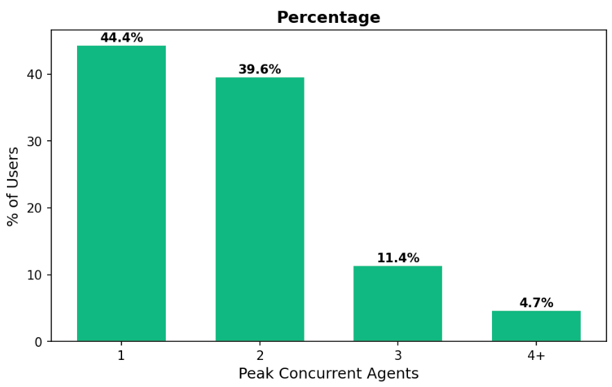
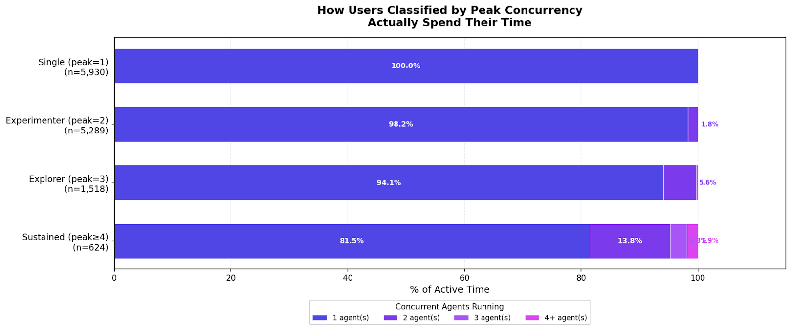
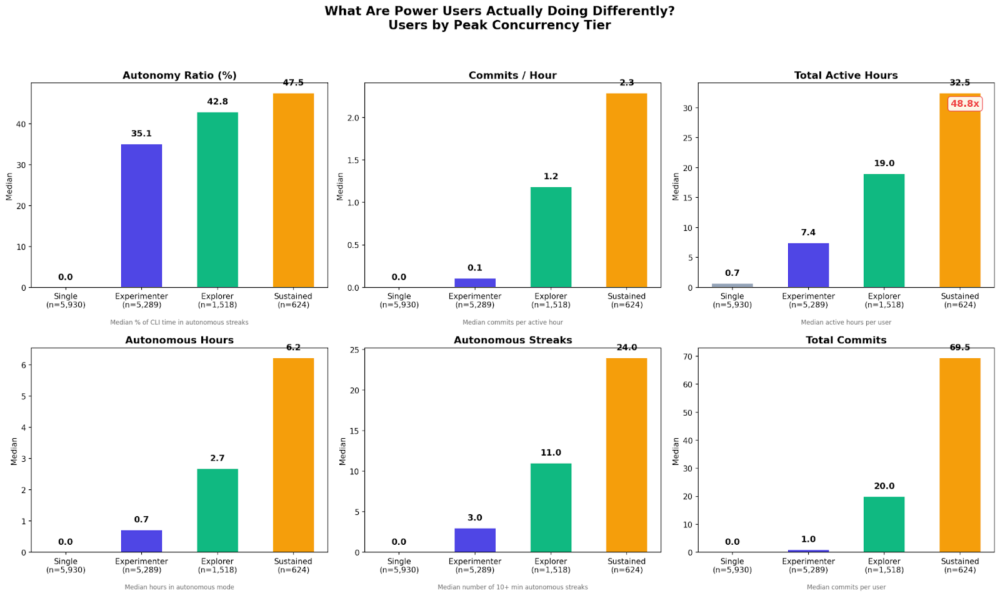
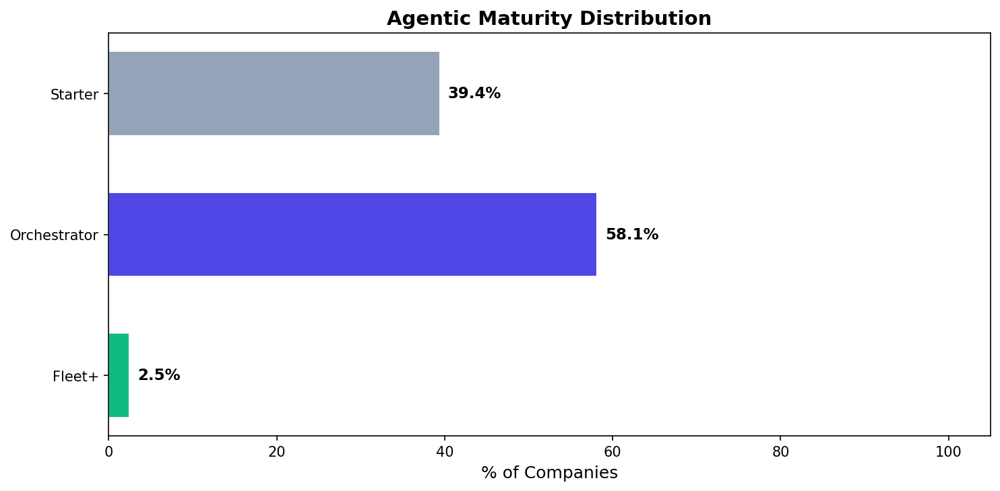
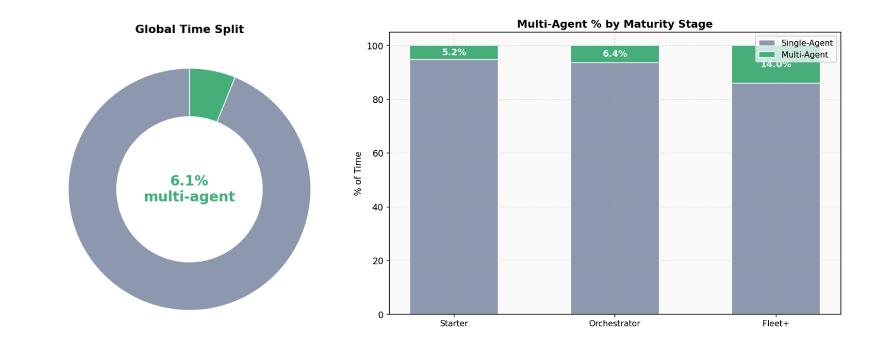
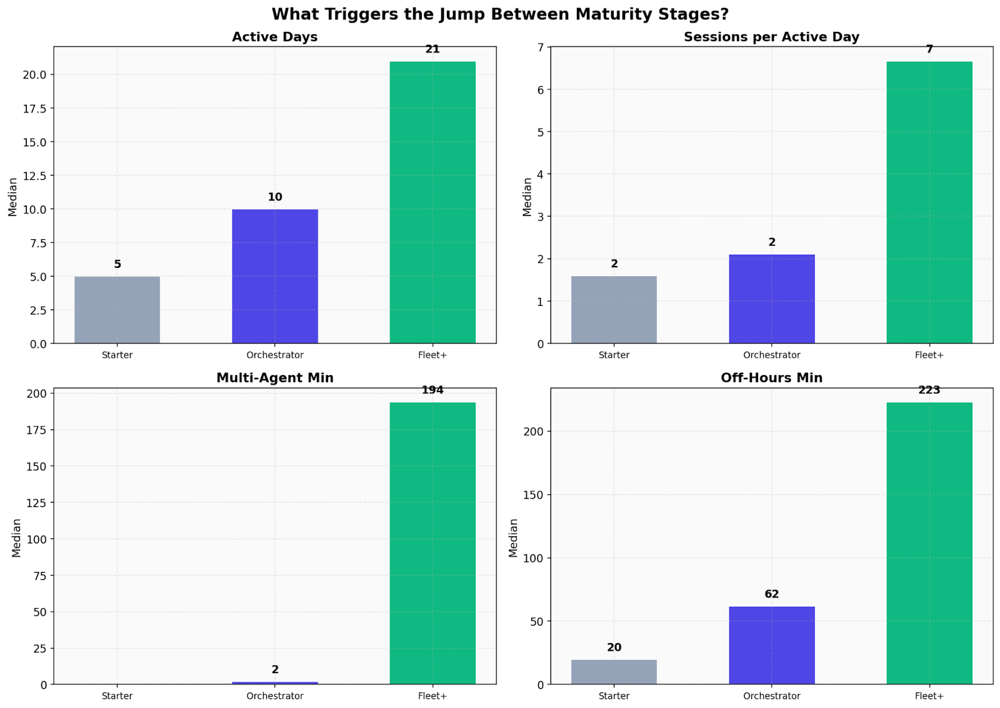

# Measuring AI Agent Concurrency

*A research piece on AI agent concurrency using Claude Code telemetry*

> Originally published on [Jellyfish Research](https://jellyfishresearch.substack.com/p/measuring-ai-agent-concurrency) on 2026-03-23.

Agents, Agents and yes more agents. This is the decade of agents and every company, startup and business is looking at how to use them and implement them. Understanding how agents are running at scale help us understand how productivity is impacted by AI agents.

We analyzed millions of data points from Claude Code telemetry and we asked: *How many agents each user is running at the same time ? Are users spending most of their time with multiple agents ? How many companies are running multi-agentic systems ?*

## Main Findings:

*User activity findings*

- **Multi-agents systems are just starting out and users are mostly running one or two agents most of the time.** Using multiple agents at once is not the most adopted pattern yet. 84% of users are still running one or two agents at a time.
- **Users running multi-agent spend most of their time with one agent.** Users running more than three agents at a time, still require to spend most of their time in a single agent terminal. Even for users using multiple agents, 80% of their time is spent within a single agent. We can’t verify how this workflow is being used but we have some hypotheses:

  - **Attention Span:** Users hit the *attention barrier* when managing more than two agents at the same time.
  - **Background Autonomy:** Some agents run in the background with minimal supervision needed, reducing the need for active attention showing early sparks of background autonomy.

**Users running multi-agent systems are more productive per hour, and more engaged overall.** They commit more, are more productive per hour and run agents with more *background autonomy*. Engagement and *maybe* curiosity seems to be what is sparking this set of users to run multiple workflows in parallel.

*Company activity findings*

- **2.5% of companies are using a** ***“fleet of agents”*****, the majority of companies are running 2 agents in parallel**.Agents are being implemented in an orchestrated pattern but we are not seeing a significant number of companies implementing agents at scale. We suspect this is related to infrastructures challenges, budget limitation or educational learning process.
- **Companies running a** ***fleet of agents*** **spend only 14% of their time in using multi-agentic mode.** We can’t validate if this is a consequence of the multi-agentic system or a limitation of the current state of companies implementing this pattern. This pattern follows the same user conclusion. Are companies running true background autonomy agents that don’t require supervision or interactive agentic workflows per user are limited by the initial experiment and system design?

Below we present our methodology and findings in detail. Our main conclusion is that managing multi-agent systems will require a new paradigm. Neither current infrastructure nor human attention is sufficient to scale agent concurrency through interactive management alone. The transition from interactive concurrency to background autonomy—what we might call the “agentic barrier”—is the phase change the industry needs to navigate. Novel solutions are being developed by startups and power users to build orchestration layers that reduce the need for constant human attention. This was our first step toward understanding how users run agents concurrently, the current stage of maturity, and what comes next.

## Methodology

What is an agent and how should we define it? There are a variety of definitions of what an agent is and how we should measure it.

Another complexity of studying agents is the fast evolution of the agent landscape and its workflows, as we concluded in our previous research[^1] - In a span of months new workflows appeared moving the user away from the IDE to a fully agentic workflow.

With these two challenges, how should we study and measure agents running concurrently?

We took a pragmatic approach to studying agents and we used the definition that an agent is *“**An LLM agent runs tools in a loop to achieve a goal”.***[^2]

Next, we defined a set of metrics to measure agentic concurrency using Claude Code telemetry data. The dataset covers a rolling 30-day window with ~19M rows of active time data. This dataset offers a useful sample for studying concurrency at the session level, with its own limitations: it captures only one tool in the market and does not reflect agent concurrency across different providers.

## Main Findings:

### **Multi-agents systems are just starting out and users run one or two agents**

*How many agents are users running concurrently?* We measured this by tracking how many Claude Code sessions are active in the same time interval per user.

Most users run agents solo or in pairs—84% of users still run one or two agents at a time. To our surprise, we expected a heavier distribution toward three or four-plus concurrent agents.

**Figure 1.** *Distribution of users by peak concurrent agents. The vast majority of users (84%) run only one or two agents at a time, with a steep drop-off at three agents (11.4%) and only 4.7% reaching four or more. Data reflects the 30-day window of Claude Code telemetry.*

It turns out the average user may still be in the early stages of the learning curve. But there is also a deeper question: Can we sustain multiple spans of attention to run different projects at the same time?

One limitation of our data: we cannot determine whether users running multiple agents are breaking down the same project across sessions or running entirely separate projects. We also cannot see whether individual sessions spawn Claude Code sub-agents internally. Nevertheless, we asked: *Are users interacting simultaneously with all their agents equally?*

### **Users running multi-agent spend most of their time with one agent**

*Can users actively work with multiple sessions in parallel ?*

It is surprising to see that running multiple agents simultaneously doesn’t mean that agents are being used equally but rather in a more passive manner. Is this a feature or a bug ? We can’t verify how this workflow are being used but we have some hypotheses:

1. **Attention Span:** Users struggle to sustain the same level of attention across all of their agents. As Andrej Karpathy put it, “*We will need a bigger IDE*”[^3]. The current tooling assumes a single-focus interaction model, and splitting attention across multiple terminals degrades the quality of each interaction.
2. **Background “autonomy” emerging:** Some tasks require less active supervision than others, allowing certain agents to run semi-independently. This is not true background autonomy—where agents execute end-to-end without human input—but rather a transitional pattern where one agent gets active attention while others idle or run simple tasks.

**Figure 2.** *Time-weighted concurrency distribution by user tier. Even users who have reached higher peak concurrency levels spend the overwhelming majority of their active time—over 80%—focused on a single agent. Only Sustained users (peak ≥ 4) show a meaningful share of multi-agent time, with 13.8% at two agents and 3.9% at four or more.*

The attention barrier limits interactive concurrency. When a user manages multiple agents interactively, they are context-switching — prompting one agent, waiting, switching to another, prompting again. The agents take turns being active because the human can only drive one at a time. Adding more terminals does not add parallel throughput; it adds more things to serialize through. Current tooling assumes a single-focus interaction model, and splitting attention across agents degrades the quality of each interaction rather than multiplying output.

Background autonomy is what unlocks actual concurrency. The small fraction of time that users do sustain multiple agents maps almost directly to moments where one agent runs semi-independently while the user drives another. This is not yet full background autonomy — agents executing end-to-end without human input — but a transitional pattern where one agent receives active attention while others coast on simpler or longer-running tasks. It is this emerging autonomy, not multitasking skill, that creates the real multi-agent minutes in the data.

The implication is clear: scaling AI leverage per developer is not a matter of opening more terminals. It requires agents capable of independent execution and tooling designed to orchestrate them. Until then, human attention remains the binding constraint on AI throughput.

### **Multi-agent users are more more productive per hour and more engaged overall**

**Figure 3.** *Behavioral comparison across peak concurrency tiers. Sustained users (peak ≥ 4) show dramatically higher autonomy (47.5% vs 0%), commits per hour (2.3 vs 0.0), total active hours (32.5 vs 0.7), and total commits (69.5 vs 0) compared to single-agent users. Each panel shows median values per tier across a 30-day window*

## Company View

We wanted to explore how companies are running agents to see whether organizational patterns differ from individual user behavior. In this section, we analyze company-level concurrency patterns and the maturity stages that emerged.

We categorized each company’s maturity stage by evaluating the behavior of the majority of its users and assigning the corresponding level.

### **2.5% of companies are using a “fleet of agents”, majority of companies are running 2 agents in parallel**

*What level of maturity are companies exhibiting ? How many agents are companies running concurrently?*

**Figure 4.** *Agentic maturity distribution across companies. The majority of companies (58.1%) fall into the Orchestrator tier, typically running two agents in parallel, while 39.4% remain at the Starter stage. Only 2.5% of companies have reached the Fleet+ tier, indicating that large-scale multi-agent deployments are still rare.*

Interestingly when we analyze behaviour at a company level, we see that the majority of companies are acting as *orchestrators*. Meaning that the majority of users per company are running two agents in parallel.

We suspect this is part of a learning curve where users are getting more proficient and companies providing richer tools for orchestration and budget to *test and learn.* We can’t validate if this is a trend where we will see more companies running *fleets* of agents. But based on our previous research, it seems that we will have more advanced infrastructure to run a fleet of agents, which could accelerate movement along the maturity curve.

### **Companies running fleet of agents, spend only 14% of their time in using multi-agentic mode**

**Figure 5.** *Global and per-stage breakdown of time spent in multi-agent versus single-agent mode. Across all companies, only 6.1% of active time involves multiple concurrent agents, out of +7 million total active minutes*

Companies running fleets of agents spend only 14% of their active time in multi-agent mode. This mirrors the individual user finding: interactive concurrency—actively managing multiple agents—consumes a small fraction of total time, likely because human attention remains the binding constraint. At the same time, we can’t validate if these are the first sparks of background autonomy of agents running in the background without requiring the user’s attention.

Independently if any of these statements are true, this suggests a future where managing this fleet of agents could require less active time on each individual agent but more time in a meta system organizing and orchestrating agents - something like what Cursor built around [self-driving codebases](https://cursor.com/blog/self-driving-codebases?utm_source=tldrai) orchestrating thousands of agents simultaneously or coordination apps emerging like [Conductor app](https://docs.conductor.build/)

### **More active days, more multi-agents minutes, and agents running outside of normal hours**

*Are mature companies doing something different vs nascent ones ?*

**Figure 6.***Behavioral triggers that differentiate company maturity stages across four dimensions. Fleet+ companies show substantially higher active days (21 vs 5), sessions per active day (7 vs 2), multi-agent minutes (194 vs 2), and off-hours activity (223 vs 20 minutes) compared to Starter companies.*

The off-hours activity signal is particularly noteworthy. Fleet+ companies show 10x more off-hours agent activity, suggesting early signs of background autonomy—agents running outside of normal working hours with reduced human supervision. Could this be the first spark of experiments of long running agents in the background, trying to replicate an *OpenClaw* experience running their *own computer* 24/7 ? That could also be probably true.

### **Notes & Limitations:**

This research was a first step. We analyzed what we can with current agentic activity and we encourage transparency of the limits that our data can’t tell:

- We analyzed Claude Code telemetry at the session level. We defined a Claude Code session as a unit of agent activity, but we could not measure sub-agents spawned by Claude Code within a session.
- This analysis covers a 30-day period, which is our current analytical window. Agentic patterns like concurrency are emerging and evolving quickly. We plan to extend this analysis over time to detect trends, but the current time frame limits what can be observed.
- We wanted to contrast different providers to compare Claude Code’s agentic features against alternatives, but we were limited by the data currently available to us.

### **What’s Next ?**

Seeing only a small fraction of companies showing multi-agentic patterns reminds us that the industry is moving fast, but organizations and companies require time to implement new features and patterns in their current workflows. Understanding how to measure agentic behaviour like concurrency was a relevant first step to understanding how the development cycle of software is evolving.

The **agentic barrier(**or attention barrier**)** is a central challenge. Our data shows that the transition from interactive concurrency to background autonomy is where the industry stalls. Users can spin up multiple agents, but they cannot meaningfully interact with more than one or two at a time. Crossing this barrier—through better orchestration tooling, trust frameworks, and infrastructure—is the phase change that will unlock true multi-agent productivity.

Infrastructure for **background autonomy** is needed. Companies should start asking how their infrastructure will support running a fleet of agents that operate with minimal human oversight. This goes beyond simply scaling terminals—it requires new patterns for monitoring, error handling, and human-in-the-loop escalation.

From a research perspective studying autonomy is an aspect that we will monitor to understand how this transition is happening and how users are solving some of the challenges mentioned.

### **Appendix**

- **Agent:**Unique session of Claude Code instance - compatible with Simon Willison definition of an agent.
- **Concurrency:** How many agents run simultaneously
- **Interactive Concurrency:** Agent running at the same time requiring human interaction to run
- **Background Autonomy:** Agents capable of running with minimal or null human intervention
- **Peak Concurrency:** Maximum number of agents running at a specific time
- **Autonomous Streak:** Consecutive minutes in a single session with only CLI activity, unbroken by any user action (type=user). Gaps in agent activity (e.g., waiting for API or build responses) do not break the streak; only human intervention does.
- **Autonomous CLI Minutes:** Total CLI-only minutes within qualifying autonomous streaks for a user or session. Minutes from short, non-qualifying streaks are excluded.
- **Autonomous Hours:** This measures the total independent agent work time in qualifying streaks.
- **Autonomous Streak Count:** The number of qualifying autonomous streaks for a user or session.

**Concurrency Type:**

User tiers are classified by peak:

- Single (peak = 1)
- Experimenter (peak = 2)
- Explorer (peak = 3)
- Sustained (peak ≥ 4)

Company maturity stages use the company median max peak:

- Starter (≤ 1)
- Orchestrator (≤ 3)
- Fleet Manager (≤ 6)
- Fleet+ (> 6)

Companies are categorized by their dominant active cohort to assign a maturity stage

[^1]: https://jellyfishresearch.substack.com/p/measuring-agentic-workflows

[^2]: https://simonwillison.net/2025/Sep/18/agents/

[^3]: [Link](https://x.com/karpathy/status/2031767720933634100)
