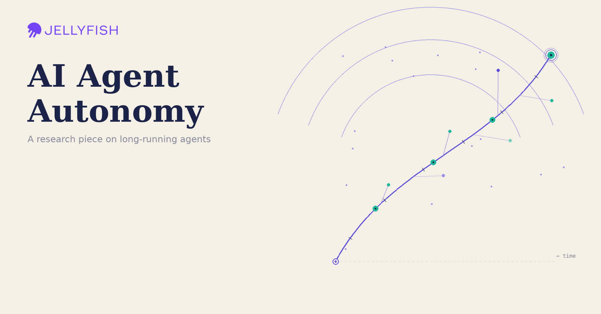
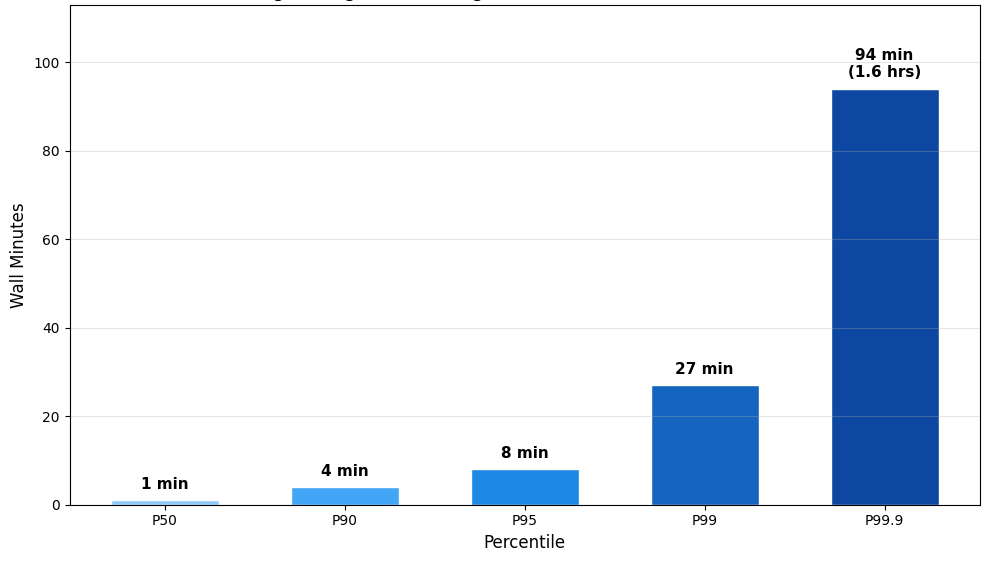
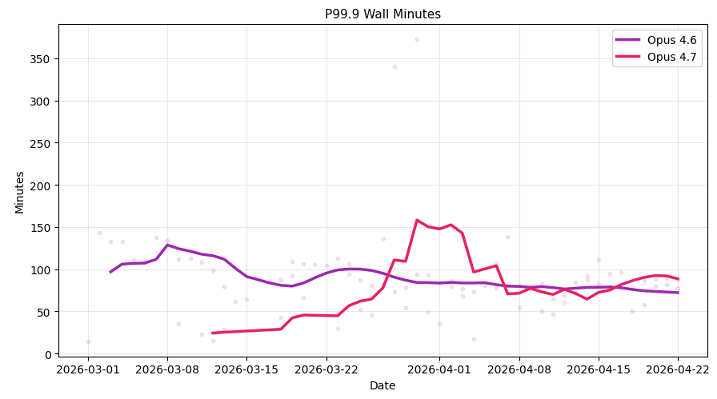
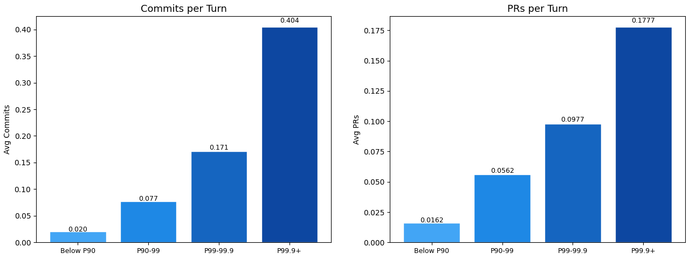
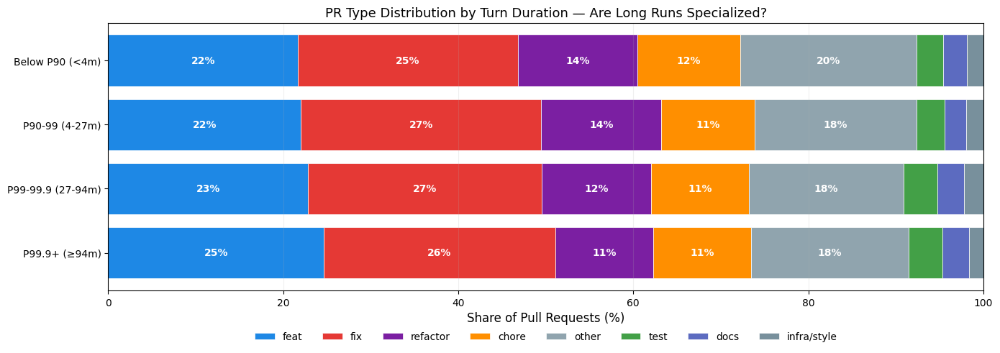
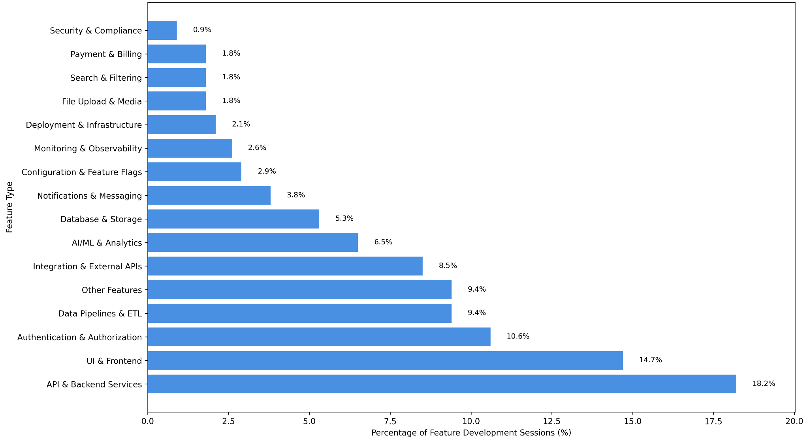
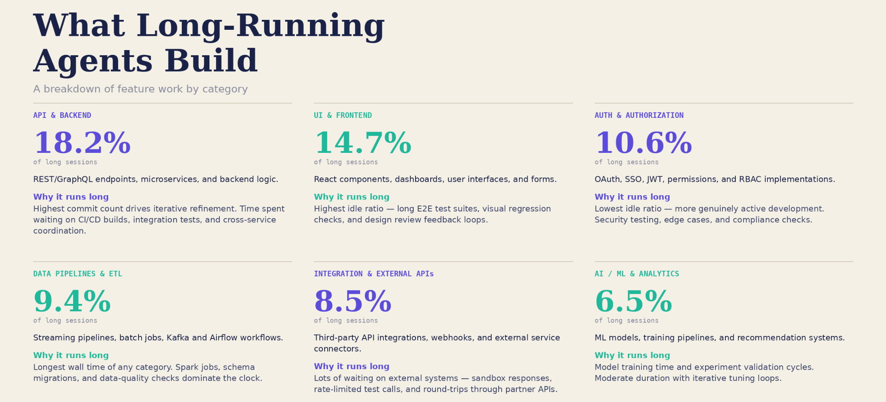
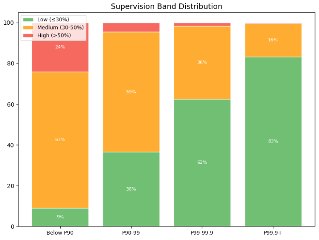
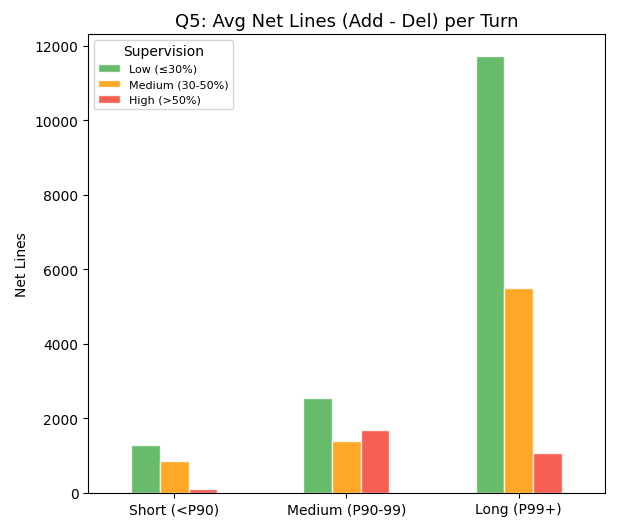

# AI Agent Autonomy

*Autonomous agents are becoming more ubiquitous, with releases from the industry and users experimenting with running an AI on their computer. We asked ourselves: what does autonomy look like in AI age*

> Originally published on [Jellyfish Research](https://jellyfishresearch.substack.com/p/ai-agent-autonomy) on 2026-05-07.

## Main Findings:

- **Sessions on average are very short in span, but the top 0.1% of agents are running for more than an hour**
- **New models like Opus 4.7 are increasing the time agents can run on long-running tasks**
- **Long running agents are more productive both in commits and PRs and do more feature work and less refactoring work compared to short running agents**
- **+80% of long running turns present low supervision involvement and low supervision produces the most code during long tasks**

Below we present our methodology and findings in detail.

Autonomy is a nascent concept in AI agents and the industry is just adapting to the idea of delegating to a system running for hours. The trend seems to be that users will get more comfortable with computers running and taking longer to arrive at a decision. According to [METR](https://metr.org/blog/2025-03-19-measuring-ai-ability-to-complete-long-tasks/), the length of tasks AI can do is doubling every 7 months. At this pace, by the end of 2026 we will have agents that will be able to run for as long as 4 hours on a single task.

We are developing this research to better understand how autonomous runs are evolving, how productive these agents are, what type of work autonomy is useful for, and whether there is an unexpected side effect for users running these long tasks.

To study autonomy we are going to focus into two traits:

- Length of task - to capture how long agents are capable of running productively
- Supervision - understand how humans are interacting with agents running long periods of time.

## Methodology

To start: what is an agent and how should we define it? There are a variety of definitions of what an agent is and how we should measure it.

Another complexity of studying agents is the fast evolution of the agent landscape and its workflows, as we concluded in our previous research: In a span of months new workflows appeared moving the user away from the IDE to a fully agentic workflow

[Measuring Agentic Workflows](https://jellyfishresearch.substack.com/p/measuring-agentic-workflows)

We took a pragmatic approach to studying agents and we used the [definition](https://simonwillison.net/2025/Sep/18/agents/) that an agent is *“**An LLM agent runs tools in a loop to achieve a goal”.***

For this research we won’t propose a definition of what autonomy is and simply define a threshold to categorize agents per turn duration and human involvement with the agent. To understand autonomy we are going to focus on agents at the top percentile, of turn duration. We define a turn as a sequence of consecutive CLI interactions bounded by human input. To analyze supervision, we condense turns into sessions, since productivity metrics align more naturally at the session level than at the turn level.

Our main findings are derived from a proprietary dataset that combines OTEL schema telemetry from Claude Code with productivity metrics sourced from GitHub signals. More information around metric definition can be found in the appendix.

## Main Findings:

### **Sessions on average are very short in span, but the top 0.1% of agents are running for more than an hour**

*How long are agents running autonomously?*

**Figure 1.** Distribution of Claude Code session duration in wall minutes across percentiles (P50, P90, P95, P99, P99.9). The median session lasts just 1 minute, but durations grow sharply in the long tail — reaching 8 minutes at P95, 27 minutes at P99, and 94 minutes (~1.6 hours) at P99.9.

We can see how the median session of an agent has a one-minute duration. To understand autonomy in agents, it is useful to zoom into the long tail and understand the behaviour of longer sessions, where only a subset of agents are running long-running tasks.

Understanding the evolution of long tasks provides us a view of how users are running agents in new creative ways and more complex tasks.

### **New models like Opus 4.7 are increasing the time agents can run on long-running tasks**

*Are long running agents running for longer periods of time?*

One interesting pattern was to see the trend of how long-running tasks are evolving with new models. We found that for the last 2 months Opus 4.6 was stable in terms of long-running turns, while when the new model Opus 4.7 was released we realized that this new model pushed the boundaries on how long agents are capable of running.

**Figure 2.** P99.9 turn duration in wall minutes over time, segmented by model (Opus 4.6 vs. Opus 4.7), shown as a smoothed trend with daily values. Opus 4.6 holds steady around 70–100 minutes, while Opus 4.7 starts lower in mid-March, spikes above 150 minutes during early adoption, and stabilizes near 90 minutes by late April.

One interesting aspect is how the time an agent is able to run has evolved. We have checked this trend across models. It’s interesting to see how users are running longer tasks over a longer period of time, but this is only true when they run the latest models like Opus 4.7.

It seems that with each new model release users start exploring capabilities and gaining trust in how long new models can run, until it reaches a stable range where long runs are consistent. The increase in time isn’t immediate, and we think this happens because models get more efficient and users need to explore capabilities until they are able to inquire around longer tasks.

### **Long running agents are more productive both in commits and PRs**

*How do long running turns compare in productivity vs short running turns?*

**Figure 3.** Average commits per turn and merged PRs per turn across four turn-duration cohorts (Below P90, P90–99, P99–99.9, P99.9+). Both metrics scale roughly linearly with duration: commits per turn rise from 0.020 to 0.404 (~20x), and PRs per turn rise from 0.016 to 0.178 (~11x). This analysis reflects all interactive Claude Code turns linked to git activity.

It’s interesting to see how productivity favours long-running agents. Although they spend more than an hour running these tasks, their productivity is substantially higher than that of agents running a short span of tasks.

This pattern is reflected in the idea of *tokenmaxing*: to see more-than-proportional gains in productivity we need to look at the top 0.1% of long-running tasks. It seems that long-running agents are paying off on whatever task they are doing, which uncovers the following question: *what type of tasks are these long running agents running? Are long running agents generalists or specialists?* We explore this in the following section.

### **Long running agents do more feature work and less refactoring**

*What type of tasks are long running agents working on?*

**Figure 4.** Pull request type distribution (feat, fix, refactor, chore, other, test, docs, infra/style) by turn-duration cohort. The mix is largely stable across cohorts — feat ranges 22–25%, fix 25–27%, and refactor 11–14% — suggesting long-running agents are not specialized but rather doing the same work mix at greater volume. This analysis reflects PRs attributable to Claude Code turns across the duration distribution.

If we had to categorize long-running agents, they would look closer to generalists doing more work overall but in similar proportions to their short-running peers. With the caveat that they tend to do slightly more feature work (~3% more) and slightly less refactoring (~2% less).

### **Most of feature tasks are related to API or UI services**

*Feature development tasks by P99.9 sessions*

**Figure 5.** Distribution of feature types built across long-running (P99.9) sessions, ranked by share of feature-development sessions. API & Backend Services (18.2%) and UI & Frontend (14.7%) dominate, followed by Authentication & Authorization (10.6%), Data Pipelines & ETL (9.4%), and Integration & External APIs (8.5%); the long tail covers Database & Storage, Notifications, Configuration, Monitoring, and Security & Compliance, each below 6%. This analysis reflects 341 P99.9 feature-development sessions classified by commit and PR text.

If we zoom in into feature development to understand if this is productive work or the agent is drifting off to non-related feature work we actually see how commits and PRs are building all sorts of features, being backend and frontend the most relevant in terms of sessions.

But *why* is it that agents run for long periods of time to accomplish these tasks, our hypotheses are: either agents are drifting from their main objective and taking longer than needed or because the agent needs to wait in a sequential workflow that has high external dependencies.

From a small sample of P99.9 long runs we were able to see how one agent was running over 3 hours because it was waiting for a CI/CD process to finish or because an agent was running a cron job every 10 minutes without any output just checking almost as a “bot” and less than an agent.

We studied in depth each of these feature types that are acting like agents (excluding any bot behaviour) and reached on why each of these features might be taking longer times to finish by analyzing commit text and PR text.

**Figure 6.** Qualitative deep-dive into the top six feature categories from long-running (P99.9) sessions, pairing each category’s share with a “why it runs long” annotation. API & Backend (18.2%) drives duration through iterative refinement and waits on CI/CD, integration tests, and cross-service coordination; UI & Frontend (14.7%) and Data Pipelines & ETL (9.4%) run long mainly through idle waits on E2E suites, visual regression checks, and Spark/schema-migration jobs; Auth & Authorization (10.6%) shows the lowest idle ratio — meaning more genuinely active development on security and edge cases; Integration & External APIs (8.5%) is dominated by waits on third-party systems; AI/ML & Analytics (6.5%) reflects model-training and experiment-validation cycles.

Although agents run for long periods of time, the agent probably isn't active the whole time — it's waiting on external dependencies, depending on what the task is doing. Long agent runtimes might just be a reflection of how today's software is built, and as agents compress their internal cycle time, inefficiencies in sequential workflows will become more evident.

### **Supervision**

We define supervision as the percentage of time a human is involved per turn. We want to understand how supervision affects long running tasks and code quality output.

*Is supervision affecting quality of work, and if so how?*

### **+80% of long running turns present low supervision involvement**

**Figure 7.** Share of turns falling into Low (≤30%), Medium (30–50%), and High (>50%) supervision bands across the four turn-duration cohorts, where supervision is defined as the percentage of turn time the human is actively involved. Low supervision rises sharply with duration — from 9% in sub-P90 turns to 83% in P99.9+ turns — while high-supervision turns nearly disappear in the long tail.

### **Low supervision produces the most code during long tasks**

Sessions where the human barely types (≤30% user share) generate 11x more net lines per turn than high-supervision sessions.

**Figure 8.** Average net lines of code (additions minus deletions) per turn, split by duration cohort (Short, Medium, Long) and supervision band (Low, Medium, High). Long-duration, low-supervision turns produce ~11,800 net lines on average — roughly 11x the output of long-duration, high-supervision turns (~1,000 net lines) — and the gap is invisible in shorter cohorts.

As we observe, the long-duration turns tend to create more lines of code when there is low supervision, reflecting the new workflow of “letting it run” and letting agents build the code without checking or corroborating. What’s interesting is that when supervision is high for the longest runs, the net added code is less than that of the previous (medium-duration) cohort. This could be because users running agents for longer also have a higher bar on correcting what Claude is generating as a solution or simply because the type of task requires less code and more external dependencies.

We don’t know if human supervision it’s because there is degradation after running for long hours(and more human correction is required), or simply because of the type of task, which requires less code when there is human involvement. Low supervision may also correlate with sessions where the agent drifts — taking the user down a rabbit hole without converging on a stable solution. Drift, coherence, and supervision are areas we plan to continue monitoring in future research.

### **What’s Next?**

If 2026 was the year of coding agents, 2026-2027 will be the year of autonomous agents running 24/7. We suspect that new bottlenecks will emerge: like infrastructure and reviewing the work agents are running in the background. Infrastructure will become critical as agents scale up, where having a surface area available for any numbers of agents requesting programmatic **access will be business critical.**

In the future we want to follow our research on how code quality might be affected by autonomous agents and how solutions like Openclaw, Hermes agents, NemoClaw and headless Claude Code agents are being used under the new SDLC model. If these solutions end up being the new industry standard then agents will diffuse into other areas beyond coding.

### **Notes & Limitations:**

- **Data coverage:** Can’t differentiate between a human interrupting a run vs. providing more context to the agent.
- **User linkage:** Only sessions from companies with GitHub integrations (via Jellyfish) produce commit/PR linkage. Companies without GitHub data contribute turn-duration metrics but not productivity metrics.
- **OTEL Schema:** The schema we use as data source, doesn’t expose a direct invocation-mode field, so we’d have to infer it from terminal.type and query_source, which we haven’t done.

### **Appendix**

- **Agent:** Unique session of a Claude Code instance - compatible with Simon Willison’s definition of an agent.

- **Session:** One unique session_id in the OTEL telemetry. Represents a single continuous Claude Code process invocation.
- **Turn:** A stretch of consecutive CLI-active minutes within a session, bounded by human interactions. Starts at the first CLI minute after a user minute (or session start) and ends just before the next user minute (or session end).
- **Active minutes:** Count of minutes in the turn with at least one CLI heartbeat.
- **Wall minutes:** (turn_end − turn_start) / 60 + 1. Includes idle gaps where the CLI was not active
