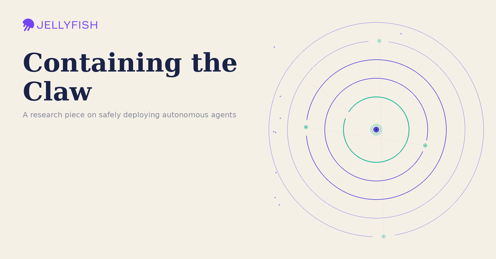
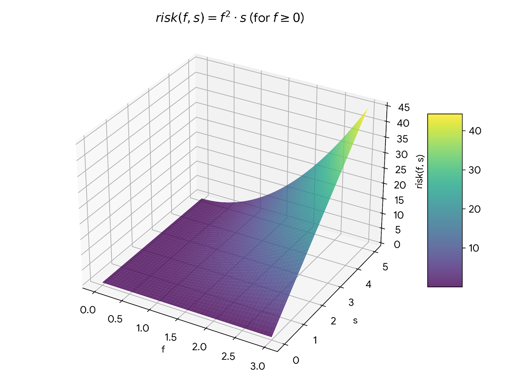
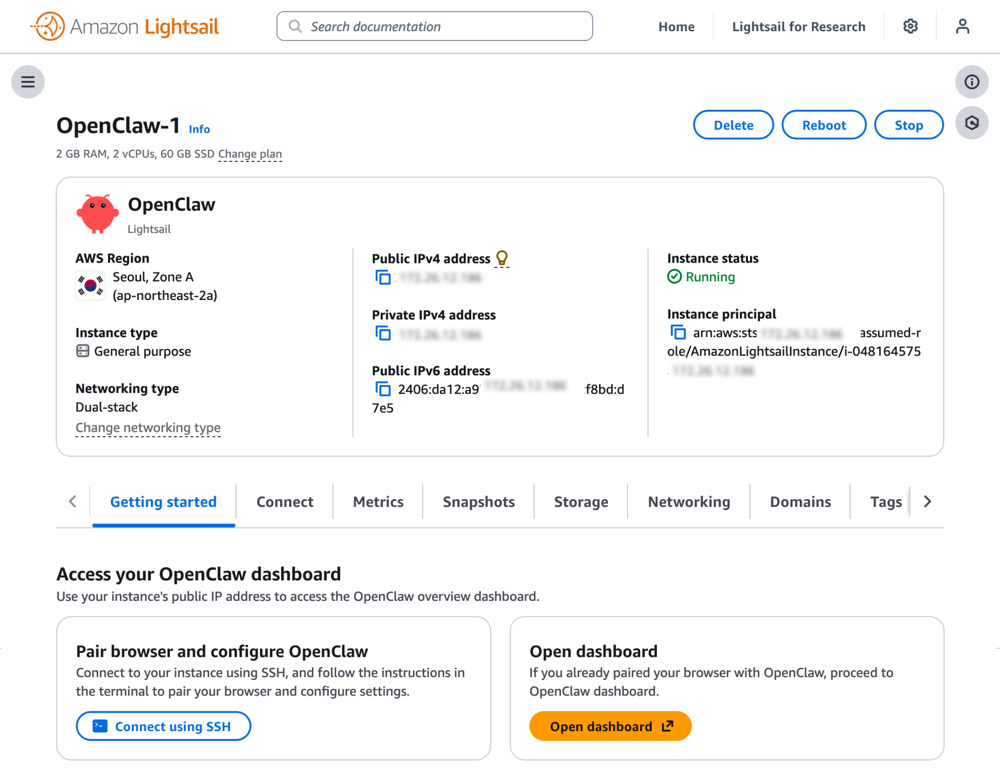

# Our Journey with OpenClaw: Jellyclaw

*At Jellyfish we at the research team are looking for ways to innovate and research new trends. Openclaw was one under our radar since it’s inception and we decided to start this journey to understand*

> Originally published on [Jellyfish Research](https://jellyfishresearch.substack.com/p/our-journey-with-openclaw-jellyclaw) on 2026-05-21.

Authors: Josiah Bruner , Tomas Pardiñas

# Context

When Openclaw came out it changed the AI industry in a similar way ChatGPT did and rapidly became one of the fastest growing repos in history to have more stars.

Even major AI players named it:

> *As the most important software release in history, calling it the “new operating system” for agentic AI [(1)](https://fathomjournal.org/3b2e0f42smm/51e19d92-5uQcDQs2SfQ.html)*

During launch in February our journey started with major roadblocks - it seemed to be a great tool for consumers to experiment with but major security concerns were still unsolved leading to a wave of articles naming it “Unusable” or “Giving the keys to the kingdom”.

This slowed us down to verify if concerns were genuine or not, but eventually good ideas win out and we decided to start simple and take the necessary precautions.

From our research, autonomous agents are becoming more present and power users are using agents to run on a single task for more than 160 minutes per our last research. Although this was based on usage of Claude Code, we realized that this same behaviour is becoming present in other agents like Openclaw and we decided to research them.

# Build it simple and show it works

The first time a big idea is released it generates a lot of excitement and suspicion, fear can affect reasoning and bypass it entirely. This happened throughout history with major inventions, my favourite one is when bridges were first built and citizens didn’t believe they were safe to use. To prove it worked, it needed a “show me, don’t tell me” moment, in 1884 when the Brooklyn Bridge was inaugurated 20 elephants at the same time crossed the bridge to show it was safe - *show me don’t tell me*.

We decided to start simple and move forward with more complex use cases as we go. If we could at least demonstrate in a simple environment that Openclaw is safe, then we could move faster to understand Openclaws capabilities.

# Security

Jellyfish’s security program heavily prioritizes understanding *risk* and ensuring such risk is reasonable for the business and our customers before pursuing any initiatives. We do this using standard security engineering practices (threat modeling, etc.), but uniquely incorporate actuarial-style concepts to ensure there is statistical rigor in our methods.

OpenClaw deployments are a unique challenge. OpenClaw is highly configurable, and its own security model is highly dependent on such configuration (their [security documentation](https://docs.openclaw.ai/gateway/security) is about 41 pages long)! Further, the attack surface is quite large and changes are made quickly. At the time of this writing, there have been [165 security advisories](https://github.com/jgamblin/OpenClawCVEs/#-all-security-advisories-165) (48 CVEs) since its release which is unusually high.

A few things became quickly apparent during the security review:

1. There is a lot of *uncertainty* in the product, use-case, and non-determinism of LLMs.
2. The primary way to reliably manage risk is to ensure the *impact* of any issues is small.
3. The secondary way to manage risk is to constrain the capabilities. This is actually very hard because as you make a system more flexible, the capabilities increase superlinearly.

This is no surprise and suggests a decent model for thinking about risk of agentic systems:

Agentic systems’ risk profile is related strongly to two factors:

1. *Flexibility of the harness*
2. *Sensitivity of the harness.*

*Graph showing risk as it relates to flexibility (f) and sensitivity (s).*

*Note that flexibility grows more quickly than sensitivity.*

To address sensitivity, we got our first security requirement for this project: no corporate (and definitely no production) data can be remotely possible to touch.

This is a guarantee we *really* needed. To ensure this we proposed an architecture where:

1. OpenClaw is deployed in a:

   1. Dedicated AWS account; and
   2. No one except a few IT and security people have access to the account; and
   3. In a dedicated VPC; and
   4. In its own EC2 instance; and
   5. Security group settings that limit any network movement in the VPC; and
   6. IAM policies that allow the EC2 instance to make Bedrock API calls and nothing else

At first glance, this seemed extremely thorough, but a key risk vector remained: ultimately our employees need to interact with this service (using a Slack channel) and we can’t guarantee they won’t accidentally provide something sensitive. We also didn’t want Slack to become an attack vector if the OpenClaw instance was to become compromised. This led to another slew of (flexibility constraint) requirements like:

1. Read-only file systems
2. Dedicated internal Slack app with minimal permissions
3. Disable “Elevated Tools” in OpenClaw
4. Disable “Plugins” in OpenClaw
5. Auto-update to ensure security updates are applied
6. TLS to ensure communication is encrypted
7. No incoming traffic (yes, even with Slack as an “input”. Thanks [socket mode](https://docs.slack.dev/apis/events-api/using-socket-mode/))

This is a lot, but it was important, especially for a phase 1 experiment. The 5-year risk of deploying OpenClaw without mitigations was estimated **two orders of magnitude** higher than with these applied.

At this point we felt confident that we could get something deployed and used by research without there being any significant risk to the business.

# Solution: Lightsail

Since we have most of our LLM models in Bedrock, using a built-in solution in AWS to run the first v0 sounded like a good first iteration.

We pursued two approaches in parallel to see which worked better:

1. Deploying our own EC2 instance and configuring OpenClaw on it manually using Docker; or
2. Using the (at the time just released) AWS Lightsail option

We quickly discovered Lightsail was the better option for an MVP, since:

1. It gave us credential-less management
2. An OpenClaw deployment that was mostly configured in a “secure default” way
3. Automatic TLS management
4. Dedicated networking and EC2 instances

Of course there were downsides:

1. It’s not particularly configurable, so doing things like read-only filesystem mounts were less trivial.
2. Some things, like filesystem access control, is more opaque.

We discovered that some of these requirements were already built in for us and it was easier to set it up instead of using an EC2 instance - with the tradeoff of losing some capabilities like setting up read-only filesystem mount directory via Lightsail.

**Some other interesting features built in for us:**

1. **Memory Snapshots:** Version control of our setup saved in AWS
2. **Buckets:** Save the data in one of AWS instances to provide context to our openclaw agent

# Initial Thoughts and Next Steps

Good news: It worked! We now have a persistent agent running that employees can communicate with.

Bad news: It basically just acts like ChatGPT when it was first released. It can answer a few questions, perform benign actions, and use the Slack channel as persistent context, but not much else. This is not surprising: we knew this was going to be heavily constrained.

This is the start of the journey of running agentic solutions and we have specific use cases we want to unlock next for both research purposes and productivity gains, specifically, we are interested in the following use cases:

- Tracking telemetry (OTEL)
- Ability to run cron jobs for long periods of time
- Give it write access to its own workspace to see if it can automate non-sensitive workflows
- Could we have it write software + push to a dedicated repo? What happens if you do?

We will continue searching for the value/risk optimum and how far can this technology help us.
