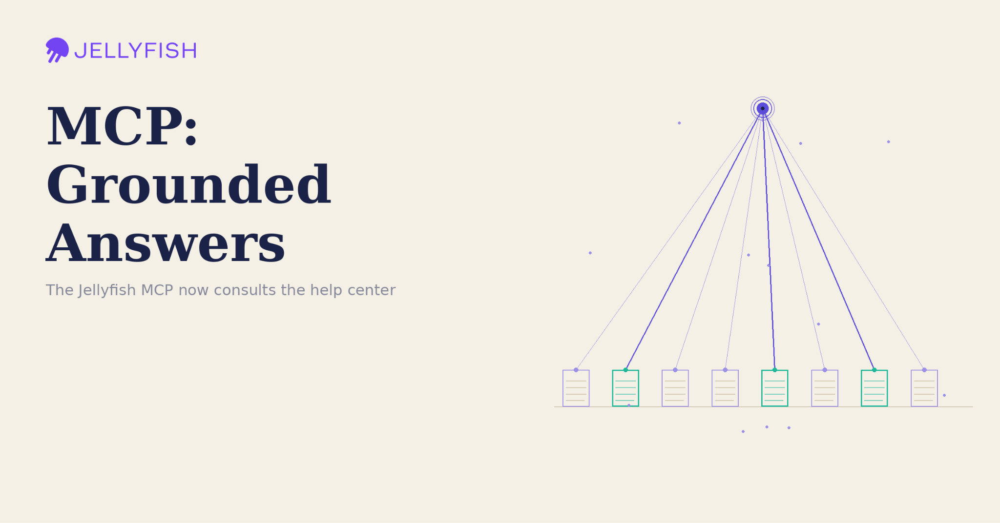
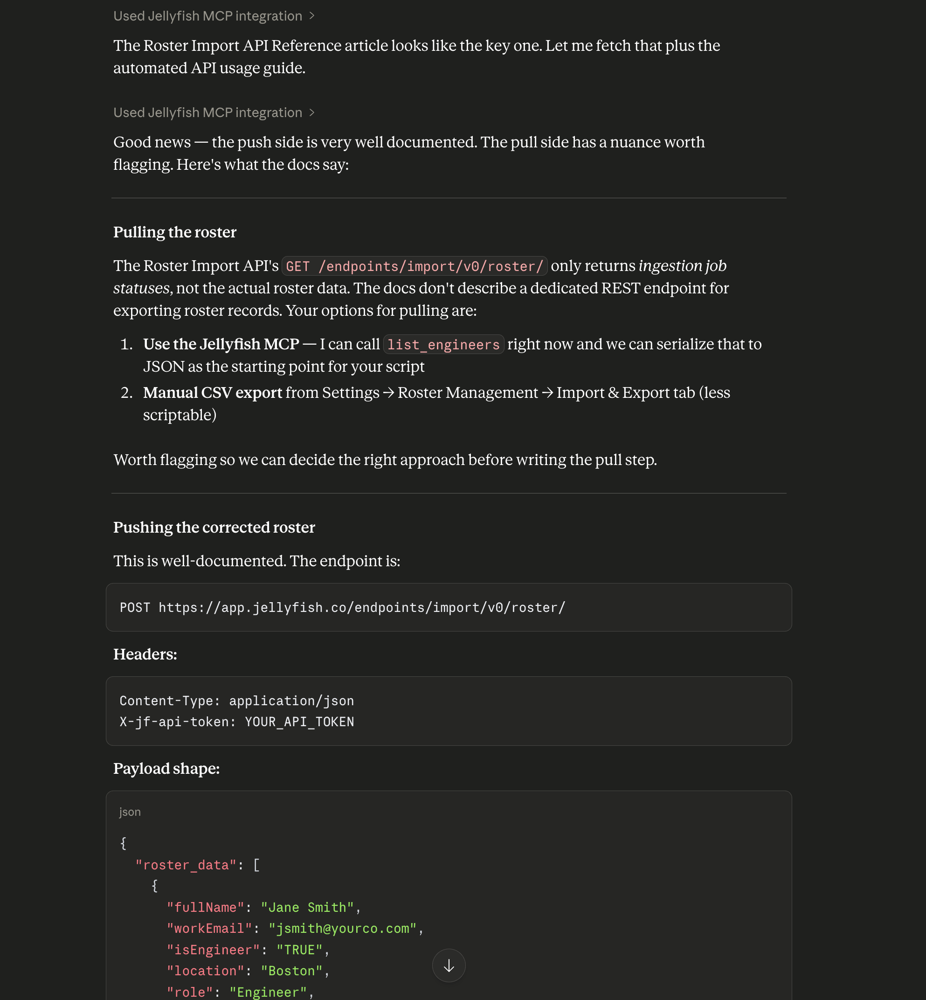

# Product Update: The Jellyfish MCP Is Now Documentation-Aware

*Grounded answers, plus real docs for your agentic coding loops*

> Originally published on [Jellyfish Research](https://jellyfishresearch.substack.com/p/product-update-the-jellyfish-mcp) on 2026-06-03.

The Jellyfish MCP just got a little smarter about Jellyfish itself. With our latest update, your AI assistant can now reach into the Jellyfish help center — searching our documentation and reading full articles on demand — so the answers it gives are **grounded** in how the product actually works.

If you’ve used the Jellyfish MCP to ask about your team’s effort allocation, delivery metrics, or AI impact, you already know how much faster it is to get insights in a single conversation. But until now, questions about *how Jellyfish works* — how to configure a feature, where a metric comes from, how to set something up — were answered from the **model’s general knowledge alone**. That left room for **vague or out-of-date guidance.**

**What’s new**

We added two new tools, backed by two new endpoints, that connect the MCP to the Jellyfish help center. When you ask a “how do I…” or “how does this work” question, the assistant first searches our documentation to find the most relevant articles, then pulls in their full content as context before answering.

**What this means for you**

- Fewer generic answers. Guidance reflects the current product, not a best guess.
- The source is right there. Responses are backed by the actual help articles, so you can dig deeper when you want to.
- One conversation, end to end. Ask about your data and how to act on it without leaving the assistant or hunting through docs in another tab.

**How to use it**

You don’t need to do anything special — just ask your questions naturally, and the assistant decides when to consult the help center on its own. Two patterns where this is especially powerful:

- **Ask questions:** in plain language via you agent. *“How do I set up SSO in Jellyfish?”* or *“How does AI Impact measure adoption?”* The assistant searches the documentation, pulls the most relevant article, and answers with steps grounded in how the product actually works — no tab-switching, no guesswork

- **Build context for agentic coding loops:** If you’re using an AI agent to write code against the Jellyfish API, the MCP can now feed it the right documentation as it works. Instead of the agent guessing at endpoints or parameters, it can search the help center, read the relevant articles, and ground its implementation in real, current docs. The result is more accurate code, fewer wrong turns, and a tighter loop — the agent pulls its own context exactly when it needs it rather than relying on what it happened to know.

  

**Image:** A documentation example showing how the MCP returns reliable information about our API.

**Setup:**

Nothing changes about how you use the MCP. If you already have the Claude Desktop extension installed, you will need to update the MCP config with the latest release 1.1.1

- **For MCP Extension Users:** Update your MCP config with new release. Install the extension by downloading the .mcpb file from the [Jellyfish MCP GitHub repository](https://github.com/Jellyfish-AI/jellyfish-mcp/releases), double-clicking to install, and providing your Jellyfish API token when prompted.
- **For NPM users:** Update will be pushed automatically, so no setup is required for existing users. New users can follow instructions from the [Jellyfish MCP GitHub repository](https://github.com/Jellyfish-AI/jellyfish-mcp/releases)

Grounding **AI in a trustworthy**, current context is one of the hardest parts of making it genuinely useful — and connecting the MCP to our own documentation is a meaningful step in that direction.

It’s one more way we’re working to make sure that when you ask Jellyfish a question, you get an answer you can **rely on and** **trust**
