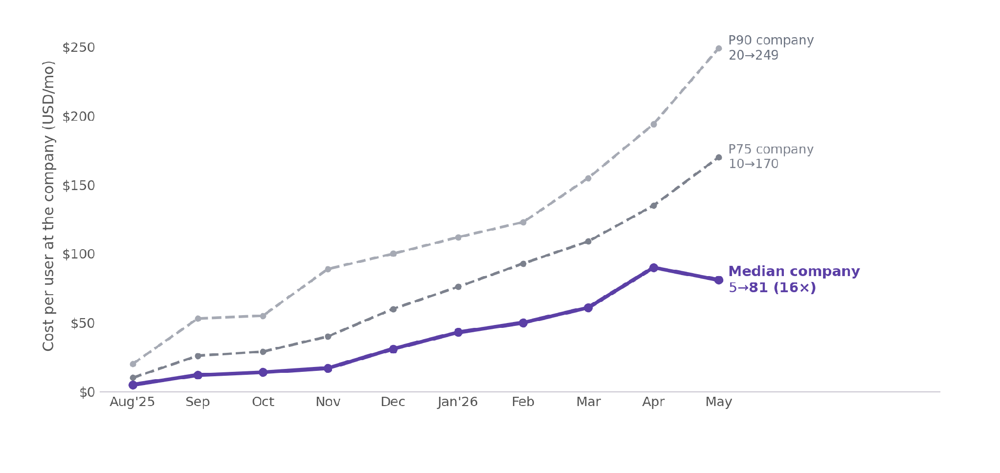
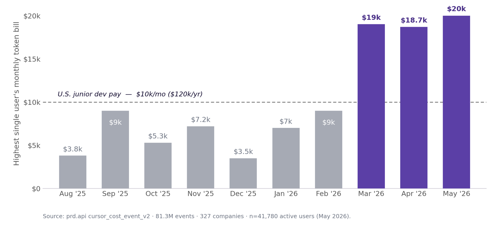
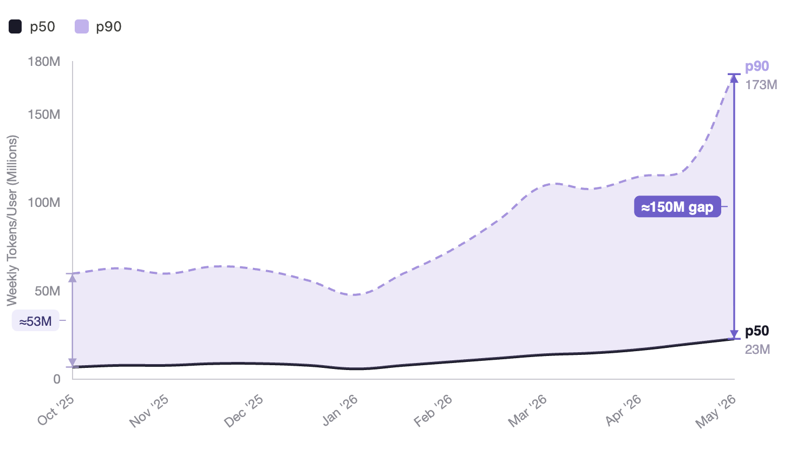
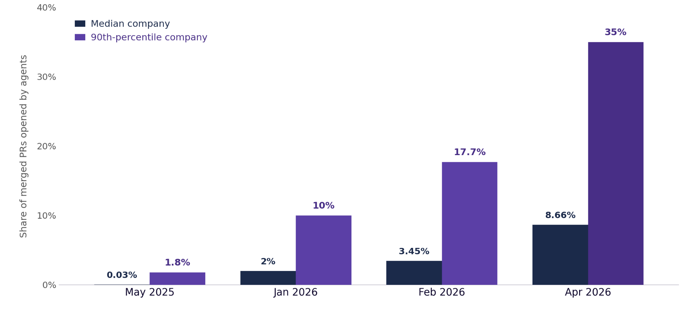
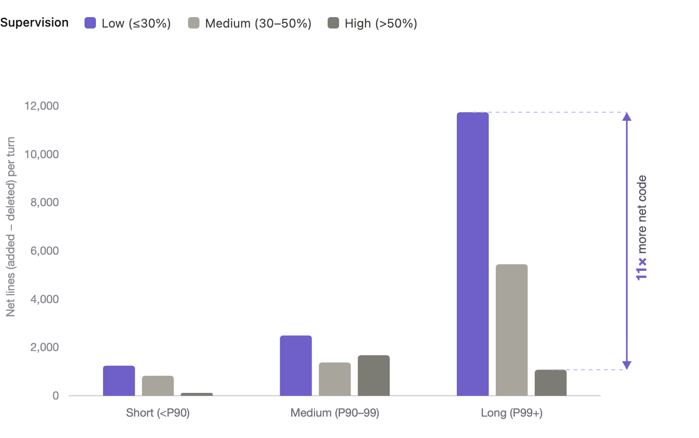
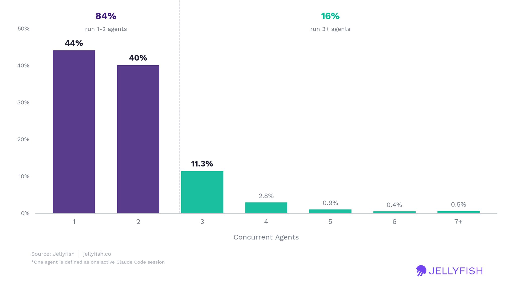

# The State of AI: H1 2026

*Exploding Spend, Diverging Returns*

> Originally published on [Jellyfish Research](https://jellyfishresearch.substack.com/p/the-state-of-ai-h1-2026) on 2026-06-23.

# **Exploding Spend, Diverging Returns**

2026 was a big year for AI, with agents taking the main stage and tools like Claude Code going mainstream. We put together a summary of what we've researched so far. The story of H1 2026 is **Exploding Spend, Diverging Returns**. You can read the first half of our report below — and if you want the full version, you can download it [here](https://jellyfish.co/state-of-ai-software-engineering/).

# **Introduction**

In March 2026, we saw the first user spend more on tokens in a month than a junior developer earns. Power users are bending what is possible in the new AI-SDLC, pulling away from the median engineer. Spend is exploding, returns are diverging, and most teams cannot yet tell which side of that divergence they are on.

Whether AI helps engineers write code is no longer the interesting question. The sharper one is about outcomes: can an agent accomplish a goal when it is set up for success, and what does that setup actually cost? Two more sit behind it. Why is the bill rising faster than the sticker price, and why do a few teams convert tokens into throughput while most do not?

This release concentrates our H1 2026 research from Jellyfish to answer those questions.

**Exploding spend, diverging returns** is the story of H1 ’26. This report highlights a major shift in how AI is used in software development:

1. **The cost shock.** Spend has gone from a rounding error to a real constraint, rising 16x across the board with a tail that now rivals a junior engineer’s salary.
2. **The economics of tokens.** What AI actually costs, why effective cost keeps rising even when sticker prices hold still, and where more tokens stop buying more output.
3. **The harness advantage.** What the best teams invest in instead of raw spend: context, harnesses, and agent-friendly codebases.

Leading teams are chasing what we call the “AI pop”: a clear jump in productivity and throughput. Standing in their way is what our research calls the **agentic barrier:** the hurdles in human attention, infrastructure, and cost that teams hit as they push agents further. There is no single way through it, but the industry is pressing on two fronts:

- Running agents on more complex, longer tasks with less supervision: **Autonomy**
- Running more agents in parallel: **Concurrency**

Both patterns drive an explosion of token consumption. At the same time, new models and agentic features keep raising the effective cost of running the same workload, so bills pile up and become unsustainable for users who are not converting tokens into productivity. A minority is converting, and converting hard. That is the divergence we are witnessing.

AI is collapsing old processes and creating new ones at an extremely fast pace. We hope this research helps you navigate what comes next in 2026.

**PART 1**

# **The cost shock - explosion of intelligence**

*Cost is rising across the board, with a runaway tail.*

For most of 2025, AI spend in software engineering was a rounding error. It was a predictable utility: you spent a little more on tokens, you got a little more code. It scaled linearly, cleanly, and predictably.

In the first half of 2026, that relationship broke.

The shift to autonomous, long-running agentic workflows didn’t just increase usage; it fundamentally changed the unit economics of software development. As teams moved from ‘AI as a chat assistant’ to ‘AI as an engineer,’ token consumption exploded—not by percentage points, but by orders of magnitude. By March 2026, we saw the first users spending more on tokens in a month than a junior developer earns. We call it the **cost shock**: a structural decoupling of spend from output that has caught the industry off guard.

**Cost per user has risen across the board:** at a typical company the median user went from about $5 a month to $81 in ten months, a 16x climb, and even mid-tier (P75) companies went from $10 to $170. This is a broad-based shift in what software development costs in the new AI-SDLC.

### Cost in AI is rising broadly for all companies, a typical company’s cost per user grew 16x in ten months

**Figure 1.** *Per-company cost per user by company percentile, Aug 2025 to May 2026. The median company’s typical user went from $5 to $81 a month, a 16x rise, increase is broad-based.*

## **Spend is rising across the board, and the extremes are shocking**

On top of that broad rise sits an **extremely skewed tail**. In May 2026, more than half of users still spent under $100 a month, yet the mean ($248) ran 3.5x the median and the 99th percentile ($2,452) ran 35x it. A small number of power users spend enormously, and **at the very end of that tail the numbers start to rival human salaries.**

Charting the single heaviest user’s monthly spend against a US junior developer’s salary (about $12,500 a month) shows how far the tail reaches: that user touched and at times exceeded the line in spring 2026.

### At the very tail, a single user’s bill has touched a junior engineer’s salary

**Figure 2.** *Highest single-user monthly spend vs a US junior developer salary (~$12,500/mo). The tail touches salary territory but does not hold there.*

Although this behavior is concentrated only on the top few percent of users at the top few percent of companies, it might be a light of the future we might expect on AI usage in software development.

Dollars follow tokens, so the next question is how fast token consumption is climbing, and then why the bill rises even when prices do not.

## **Token spend tripled since October, and power users are decoupling from the median**

Tokens are how LLMs process text, and AI labs’ business models are based on how tokens are priced and charged per million.

We have been tracking token usage, and in January something changed. November 2025 brought the release of Opus 4.5, Anthropic’s main model, and usage patterns shifted sharply afterward.

**Figure 3.** *Weekly Claude Code tokens per user, by percentile. Median usage is flat; the top decile separates and accelerates.*

Token consumption climbed steeply from the start of 2026, tripling for power users (P90) from 50M to 170M.

We can also see a **divergence** between power users (P90) and the median (P50). The first group **completely decoupled** from the rest of the group, benefiting from the increase in throughput and widening the **gap** from a 50M token difference to 150M tokens.

## **Who is justifying the bill, and why most cannot follow**

If a thin tail is pulling away, the obvious question is what that tail does differently. Three frontier behaviors separate them: they put more work through agents, they let agents run longer with less supervision, and they push on running more agents at once. Each one helps explain who sits on the paying-off side of the divergence, and why the rest are locked out for now.

### Autonomous agents are spreading, leading teams now run 1 in 3 PRs through agents

**Figure 4.** *Share of pull requests opened by autonomous agents, by company percentile. The median holds near 2% while the 90th percentile bends steadily upward.*

The clearest picture of the widening gap is the **share of pull requests opened by autonomous agents**, tracked at the company level. At the median, the line barely lifts off 2%. At the 90th percentile it rises and keeps rising: 10% in January, 14.5% by the end of February, 35% by April, against roughly 2% a year earlier. The top of the market is not adopting agents so much as compounding on them, and the distance to the median grows month over month rather than closing.

What are those leading teams doing differently while running autonomous agents? Sorting Claude Code agents by session length and by how often a human interrupted them, supervision barely matters in short and medium sessions.

In the longest sessions, the top 1% by duration, the pattern turns stark: runs left largely alone (under 30% human intervention) produce **about eleven times the net lines of code of heavily supervised runs of the same length**. Low supervision drives the most lines of code, but the biggest impact lands in the power-user segment. What duration measures here is whether the agent was set up to succeed without rescue, and the output gap suggests **power users are engineering that setup differently from their peers**.

### Long-running agents with light supervision produce 11x more code

**Figure 5.** *Average net lines per turn by session length and supervision level. Teams with low supervision and long running turns generate 11x more net code than turns with high supervision*

The longest sessions in the dataset, the top 0.1%, ran past 94 minutes, and 83% of them involved little human contact start to finish. According to **[METR](https://metr.org/blog/2025-03-19-measuring-ai-ability-to-complete-long-tasks/)**, the length of tasks AI can do is doubling every 7 months (at 50% success rate). At this pace, by the end of 2026 we will have agents that will be able to run for as long as 4 hours on a single task.

Setting agents up to complete long tasks autonomously is becoming a huge unlock, but only P99 users are seeing the gains so far. If net lines of added code is a signal of productivity of long workflows - power users understand how to run them and have increased productivity.

**Autonomy** is one of the challenges that teams are still trying to overcome. We asked ourselves: how many of these agents are power users able to run **concurrently**? To do so, we studied agent concurrency.

### Concurrency hits a ceiling: 84% run just one or two agents at once

If running agents for long periods of time in a loop with a goal until it completes is what unlocks output, the obvious next step is to run **more agents** at once. But we discovered that high concurrency levels are rare.

Measuring peak concurrent agent use across customers’ turns (each session is composed of multiple turns) hit a ceiling: **84% of active users top out at one or two agents at a time**, and even the small group launching four or more spends **over 80% of session time attending to a single agent**.

**Figure 6.** *Peak concurrent agents per active user. Almost everyone runs one or two; the agentic barrier is human attention, not tooling.*

This is the **agentic barrier** at its clearest. Human attention is the blocker on multi-agent workflows, and attention does not parallelize. Scaling infrastructure to orchestrate more than a pair of agents is not trivial either, and the industry is still building the tooling for users to scale agents. As Karpathy put it, *[we will need a bigger IDE](https://x.com/karpathy/status/2031767720933634100)*.

While agent concurrency currently faces a functional ceiling, the market is introducing solutions to address these limitations. This includes Anthropic’s release of agent teams and platforms like [Conductor](https://www.conductor.build/) that facilitate parallel agent execution. For organizations aiming to scale productivity, prioritizing new infrastructure and tools alongside strategies to manage human attention challenges has become essential. We think that the 16% of users running 3+ agents in multi-agentic workflows are highly correlated to teams spreading autonomous agents and getting the productivity gains we see in PRs from Figure 4.

Concentrated gains among elite teams are driven by these frontier behaviors. Because human attention remains a non-parallel resource, most users face rising costs with diminishing returns, while only a few outliers successfully convert high spend into significant output. Cost shock is affecting companies broadly, but these frontier capabilities are creating a divergence in productivity that median users aren’t seeing.

These three behaviors are why the gains stay concentrated. Attention does not parallelize, so only outliers turn heavy spend into output while everyone else pays a rising bill for less. The next part looks at why the bill climbs even when sticker prices hold still, and why more tokens eventually stop buying more output.

**PART 2**

# **The economics of tokens**

*Where the cost comes from, and why more stops working.*

At GTC 2026, Jensen Huang told the room that a $500,000 engineer who isn’t spending [$250,000 a year on tokens is a wasted seat](https://www.rdworldonline.com/nvidia-ceo-jensen-huang-says-spend-250k-on-ai-tokens-annually-or-hell-go-ape/). Tokens, in his framing, now belong in the comp package. Sam Altman went further, floating universal basic compute for everyone. The industry pitch is that more tokens are always worth buying, and this part is where that pitch meets the invoice. We looked into whether it is always true, and whether AI labs genuinely mean it or are selling a narrative.

To deep dive into this, we decided to study the price per token: how is the **effective cost** affected by the release of a new model, how are new **agentic features** pushing token consumption, and whether **tokenmaxxing** is the right strategy for companies to build.

### *If you want to read the full report you can do it [here](https://jellyfish.co/state-of-ai-software-engineering/)*
