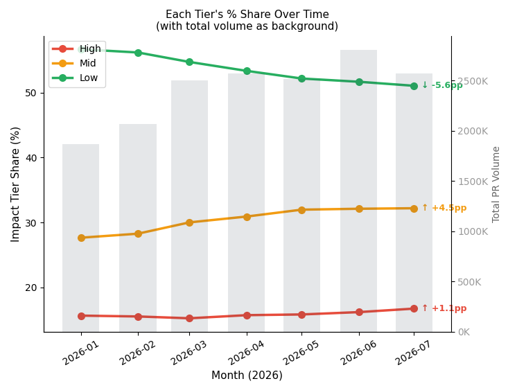
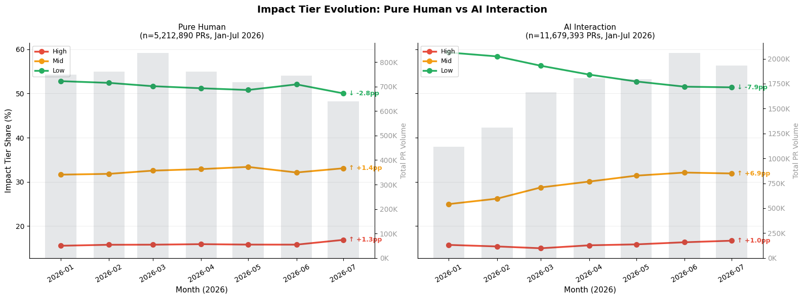
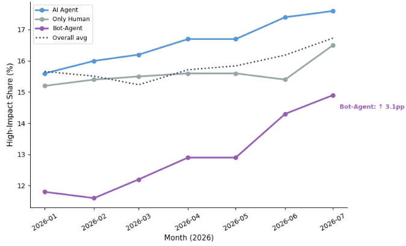
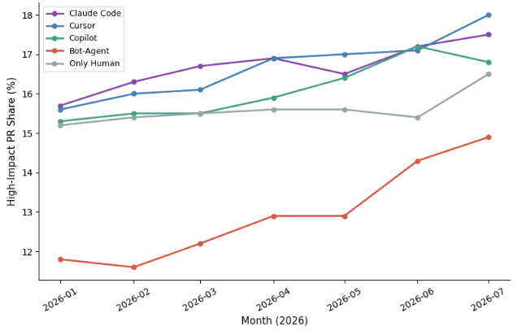
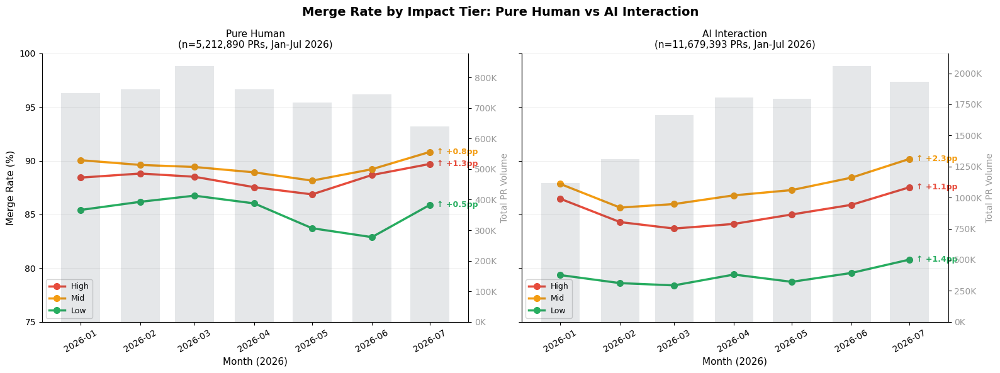
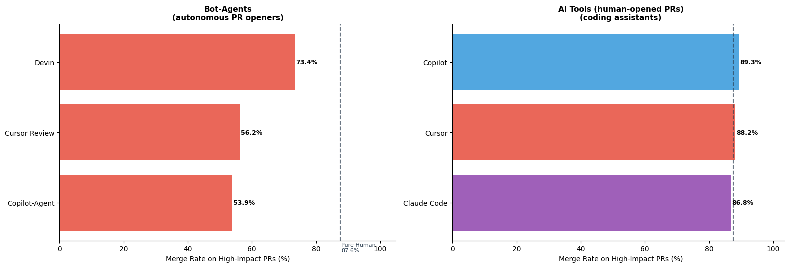
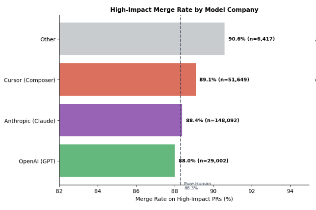
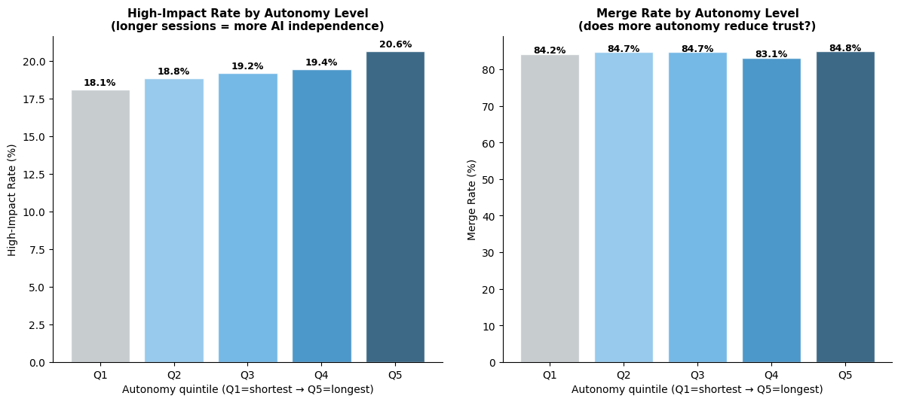

# Agentic Coding: The Impact Gap Is Closing

*Agents are spending more tokens, but are they getting more impact in organizations?*

> Originally published on [Jellyfish Research](https://jellyfishresearch.substack.com/p/agentic-coding-the-impact-gap-is) on 2026-08-17.

*We decided to study what impact AI applications are having on organizations. By studying what work is done and how humans are delegating more work or just the small hygiene work that humans don’t want to do.*

## Main Findings

- **Low-impact work is shrinking, and the Mid tier is absorbing almost all of it.** Low-impact work lost 5.6 points of share between January and July 2026. The *Mid* tier gained 4.5 of them and the remaining went to *High*
- **AI-assisted work is converging on the human distribution of impact rather than pulling away from it.** AI started the year doing disproportionately more of the *small work* and spent 2026 closing that gap.
- **For High-impact work, AI assistants are already at trust parity.** Coding assistants merge High-impact PRs at 86.7% to 89.5%, against 88.3% for pure-human PRs.
- **Which model you use barely matters. How you delegate to agents matters more.** The spread across model vendors on High-impact merge rate is almost negligible. But, the spread between assistant-authored and bot-authored High-impact PRs is roughly 30pp.
- **More autonomy correlates with more High-impact work without trust issues to merge**

# Introduction

For our research we wanted to understand how capability (i.e. model evolution) is affecting the type of work companies are doing. Our hypothesis is that as models evolve, agents are more capable of doing what we call “*Impactful work*”, not the boilerplate, small changes or irrelevant bugs in a codebase, but rather big projects with high impact in the code, and as a result in the business.

We foresee that it might not be completely linear to delegate any work to AI. Agents may be *capable* of getting the work done, but *trusting* the output generated is a different decision-making process not related to “*Can it do it*” but rather “*Who does it*”. This study was a first step toward understanding how impact is affected by *trust* and *autonomy*, but we foresee in future research other vectors like *risk* and *complexity*.

# Methodology

For this research we wanted to understand how we could study the impact of work AI is having in the industry, to do so we trained an AI model to classify PRs with multiple signals like title, body and file changes. Our hypothesis was that there is rich information about the type of work in these fields and understanding how it affects the codebase is good enough (as a starting point) to classify PRs by the impact these may have. We used our dataset with thousands of datapoints to train an open source model such as DistilBERT, some of the reasons we decided to use this family model involve: speed, size and retention. In particular, retention since it *Keeps about 97% of the language understanding capabilities of its larger teacher model* - which was exactly what we needed for this research. ([Link](https://huggingface.co/transformers/v3.0.2/model_doc/distilbert.html))

## Classification

The first step was to create a dataset with initial examples so we could train our AI model. Since we don’t have a “state of the art” dataset with gold examples, and for this research we couldn’t build one from examples labelled manually by humans, we decided to use another model to create this dataset, with human input guiding the model rather than labelling the examples directly. We prompted an LLM to guide how to interpret these data fields on what it actually means to have “High” impact (in the Appendix you can find more information on the prompts used for our initial training)

This way we could use this dataset for training and validation purposes, each PR would be classified as Low, Mid or High impact.

We used this dataset for training and validating the model and making sure that the parameters were well calibrated, avoiding overfitting and validating successfully that it could predict never-seen examples. After this we ran our model with the 2026 PRs and got our full dataset to study impact of work.

We then studied that impact along three dimensions, which structure the rest of this research:

- **Capability:** Is the mix of work shifting upward over time, and for whom?
- **Trust:** Does impactful AI work actually get merged, or does it get rejected at review?
- **Autonomy:** Does giving the agent more independence change the impact of what comes back?

# Capability

### AI is moving work from low impact to mid and high impact work progressively



**Figure 1.** *Monthly impact tier mix as a share of all classified PRs, January–July 2026. Low-impact share declines 5.6pp; Mid-impact gains 4.5pp; High-impact gains 1.1pp. Total PR volume grew 37.6% over the same window.*

We are seeing more work of high impact addressed by AI. This is interesting since we are trading off low impact work for more impactful work. AI is taking more share of relevant work and that is a promising trend. At the same time, it seems that most of this work is still shifting progressively, first in its majority to mid and then into high. A recent research from Anthropic showed how the type of work done by Claude changed substantially from October to April 2026. Particularly *sessions spent fixing broken code fell from 33% to 19% (...)*  and *that estimated value of the average session rose by 27% between October and April.* Pointing a similar finding from our study. [Link](https://www.anthropic.com/research/claude-code-expertise)

### AI-assisted work is converging toward the pure-human distribution of work



**Figure 2.** *Impact tier share over time, split by pure-human PRs (~5.2M) and PRs with AI interaction (~11.7M), January to July 2026. Pure-human work moves modestly: Low down 2.8pp, Mid up 1.4pp, High up 1.3pp. AI-interaction work moves nearly three times as far at the bottom, with Low down 7.9pp, Mid up 6.9pp and High up 1.0pp, starting from a materially higher Low-impact share in January and ending close to the human level.*

Pure human work still exists and the trend of type of work hasn’t changed over the last 6 months - when AI took off. But, what we consider low impact work isn’t disappearing and we think this won’t go away or completely collapse, not because of impact but for other reasons like **risk** or **complexity** of the work.

Imagine making a small edit in a high-sensitivity environment with time pressure from a stakeholder. A few subject matter experts probably are the best ones (yet) to handle work like this, which per our definition falls into a “Low impact tier” but is still relevant for keeping the business going.

In contrast, for PRs that have at least some AI interaction, the share of work is changing and the good news is that we are delegating more work of higher relevance, similar to our previous chart.

As teams get comfortable, the same tool gets pointed at real feature work. What we’re likely watching in this chart is a cohort of organizations moving through that sequence at different speeds, and the aggregate converging on the human mix as more of them finish the work.

### AI work is pushed mostly by bot-Agents and AI agents, but humans are still involved in high impact work

*Who is actually opening the High-impact PRs?*



**Figure 3.** *High-impact PR share by author type, January to July 2026. AI Agents rise from 15.6% to 17.7% (up 2.1pp) and stay above the overall average throughout. Pure-human PRs rise from 15.6% to 16.9% (up 1.3pp). Bot-Agents start well below the field at 12.0% and climb to 16.3% (up 4.3pp), converging on the other two by July.*

AI agents pull ahead early and stay ahead, modestly but consistently, and they’re the only group above the overall average for the whole window. Humans drift up gently, which is worth saying plainly: **humans haven’t been displaced from impactful work**. The human line and the AI line are separated by less than a point through July, and both are rising.

But one interesting behaviour is how Bot-agents are ramping up. They started the year doing markedly less impactful work than anyone else and closed most of a 3.6-point gap in seven months, which is quite a jump.

We think the mechanism is a change in what bots are being asked to do, not a change in what they’re capable of. Through 2025 the dominant bot workload on GitHub was narrow and repetitive: dependency bots, formatters, scheduled maintenance jobs. That work is Low-impact almost by construction. **The issue-to-PR agents changed the input.**

GitHub’s Copilot coding agent went generally available in late 2025 and takes an issue and returns a draft PR, and the async cloud agents from Codex, Cursor and Devin follow the same shape.

Once a bot account is opening PRs sourced from the issue tracker rather than from a cron schedule, the impact mix of bot-authored work should rise even if the underlying model never changes. Academic work tracking [autonomous coding agent activity on GitHub](https://arxiv.org/pdf/2507.15003) describes a similar pattern of ‘bots’ getting more work done.

### Claude and Cursor taking the lead of impactful work, but Bots are ramping up

*Does the tool you choose change the impact of what you ship?*



**Figure 4.** *Monthly High-impact PR share by tool and author type, January to July 2026. Claude Code (15.9% to 17.6%) and Cursor (15.6% to 18.0%) lead through most of the window, with Copilot (15.4% to 16.8%) and pure-human PRs (15.6% to 16.9%) close behind. Bot-opened task agents start lowest at 12.1% and finish at 14.9%.*

The difference between impact PR share of the main agentic tools is almost negligible, we think that this is because the capability of these agents is similar and hard to differentiate in the market. These assistants are not really different engines: they route to the same small set of frontier models, and those models have themselves converged.

We can’t distinguish between impact driving agents and users selecting an agent and seeing the distribution of PRs as a consequence, meaning that agents inherit the impact of the task rather than setting it.

The one gap that does open up is between everything a **human opens** and what a **bot opens** autonomously, and even that is about two points and closing. We’ll return to it in the Trust section, where the same comparison looks very different.

# Trust

Classifying a PR as high-impact tells us what someone attempted. It doesn’t tell us whether the organization accepted it. We will use the **merge rate** as our proxy for that. In 2025 the developer sentiment pointed to a [distrust of AI usage](https://stackoverflow.blog/2025/12/29/developers-remain-willing-but-reluctant-to-use-ai-the-2025-developer-survey-results-are-here/). We want to revisit this trend and see how it looks for 2026 by type of work.

### **Trust in AI work is improving fastest in the middle of the impact distribution**

*Is important work being delegated and trusted to AI?*



**Figure 5.** *Merge rate by impact tier over time, split by pure-human PRs (~5.2M) and PRs with AI interaction (~11.7M). Both populations improve across every tier over the window. Pure-human PRs gain 1.3pp on High, 0.8pp on Mid and 0.5pp on Low. AI-interaction PRs gain 1.1pp on High, 2.3pp on Mid and 1.4pp on Low, closing most of the gap that existed in January.*

Is important work being delegated and trusted to AI? **Yes**

First, everything is going up. Whatever else happened in 2026, review outcomes improved across both populations and all three tiers.

Second, the AI population is improving faster everywhere except the High tier, and the largest gap between AI and human work **sits at the bottom of the impact distribution rather than the top - Low impact work**. That’s counterintuitive if you expect trust to degrade as stakes rise.

We think the explanation is **selection** rather than quality. Low-impact AI-assisted work is where the **exploratory** and throwaway attempts live: the quick prototype, the spike that didn’t work out, the branch nobody bothered to close. This also points to the question of how to allocate tokens to work that is not merged and is of low impact, but probably a part of it is needed to get to new work considered “High” Impact.

High-impact AI work goes through a human who has a reason to care before it ever reaches review. The higher the stakes, the more curation happens upstream of the PR, which pushes more pressure to merge it.

### Coding agents have the same trust level as human PRs, but bots are still catching up on a trust gap for High impact work



**Figure 6.** *Merge rate on High-impact PRs only, the strictest trust test we can construct, split by autonomous PR openers (left) and coding assistants on human-opened PRs (right), against a pure-human baseline of 88.3%. Copilot (89.5%), Cursor (88.3%) and Claude Code (86.7%) all land within 1.6pp of the baseline. Bot-agents sit far below it: Devin 73.8% , Cursor Review 60.8% and Copilot-Agent 54.2%*

Intuitively this makes sense. Bots started out as autonomous workers for superficial work, bugs and trivial tasks that were taking attention away from engineers. But, as these bots become more capable and that same bot starts proposing changes in high impact work, human intervention is expected and we think that’s the reason for the gap on bot-agents. In contrast, AI tools, although autonomous, include some interaction and were created for any type of work, without the bias that a bot might have.

### Models barely matter when trusting High impact work to AI

*Does the model behind the assistant change whether the work is accepted?*



**Figure 7.** *High-impact PR merge rate by the model vendor behind the assistance, against the 88.3% pure-human baseline. Other 90.6% (~6k PRs), Cursor Composer 89.1% (~50k), Anthropic Claude 88.4% (~150k), OpenAI GPT 88.0% (~29k). The full spread is 2.6pp, and three of four vendors sit within 1.1pp of the human baseline.*

Similar to AI tools, models reflect a similar trust level when doing high impact work. Users don’t discriminate between models, and models merge at a similar rate as pure humans, meaning that there is no trust gap between frontier models.

## **Autonomy**

We study autonomy by the duration of turns per coding agent. Specifically, if an agent is able to run for a longer time without human intervention, we consider this as a more “autonomous turn” than one with multiple human interruptions.

### **High autonomy correlates with a higher share of High-impact work, without any merge penalty**



**Figure 8.** *Claude Code sessions bucketed into equal quintiles by turn duration, a proxy for AI independence (~380k sessions per quintile). High-impact rate rises monotonically from 18.1% in Q1 to 20.6% in Q5 (up 2.5pp). Merge rate is flat across the same quintiles at 84.2%, 84.7%, 84.7%, 83.1% and 84.8%, with no downward trend.*

We wanted to understand how more autonomous sessions of agents affect the share of high impact work. Do users who run agents for longer produce more relevant work? Data suggests that yes, we don’t know if high impact work also correlates with more *complexity* which means that agents actually need *more* time to deliver the work.

## **What’s Next?**

The interesting question in 2026 is no longer capability. The type of work, tools and the models have converged into a band a couple of points wide. What variance remains is **organizational**: who is **allowed** to open a **PR against what**, and **who reviews** it.

In our next research, we want to explore how *complexity* and *risk* are patterns affecting impact in organizations. We think that although agents are capable of executing high impact work, if the context and risk control isn’t suitable for a task, this makes it harder to use AI and creates friction for delegation.

We would like to delegate more work to our agents, prioritizing bigger impact per spend and focusing on what moves the needle, but not having visibility and control of what the risks are makes it harder for organizations to run these agents.

Risk and complexity are challenges that we think are pushing the SDLC measurement into new horizons.

One towards understanding *autonomous software development* on a higher level of abstraction and focusing on checking the new bottlenecks that are moving away from code production to the review line and idea generation.

This has to do with how it is more relevant to understand production of code at a higher level of abstraction than before. Since coding isn’t as scarce as before, the time around planning and optimizing resource allocation shifted towards a business question that is becoming more relevant: “Is all this code production actually having an impact on the business and how do I measure it?”

## **Notes & Limitations**

- **AI attribution is a floor, not a census.** A PR is assigned to the AI-interaction population only when we can detect the involvement.
- **Turn duration proxies autonomy imperfectly.** A long turn may reflect an agent working independently or an agent idling on an external dependency.
- **Correlation throughout.** Teams that run longer sessions may differ from teams that don’t in ways we haven’t controlled for, including codebase maturity, review culture and seniority mix.
- **Merge rate is a proxy for trust, not a measure of quality.** A merged PR is one the organization accepted, which is not the same as one that was correct.

## **Appendix**

- **Bot-Agent:** PRs opened autonomously by a non-human account, without a human initiating the PR.
- **Merge rate:** Share of PRs in a given population that were merged rather than closed or left open, over the observation window.
- **Autonomy quintile:** Claude Code sessions ranked by turn duration and split into five equal-sized buckets , Q1 shortest to Q5 longest. Turn and session definitions follow our previous autonomy research.
- **Observation window:** January to July 2026.
- **Impact tier (Low / Mid / High)**

```
  “High”: “Touches business-critical or high-blast-radius surfaces: authentication, payments, billing, data migrations, schema changes, security, public/external API, production infra config. Or changes core business logic where failure risks outage, data loss, security exposure, or revenue impact.”,

   “Mid”: “Meaningful feature or logic changes in standard application code with contained blast radius and some user-facing impact.”,

   “Low”: “Cosmetic, docs, tests, comments, formatting, dependency bumps, or trivial fixes with no business-critical surface and negligible blast radius.”
```
