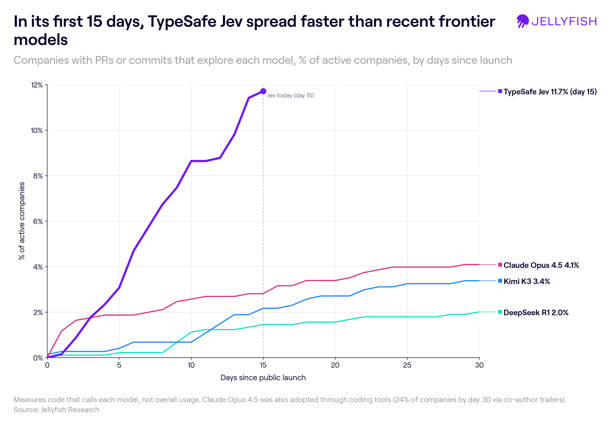
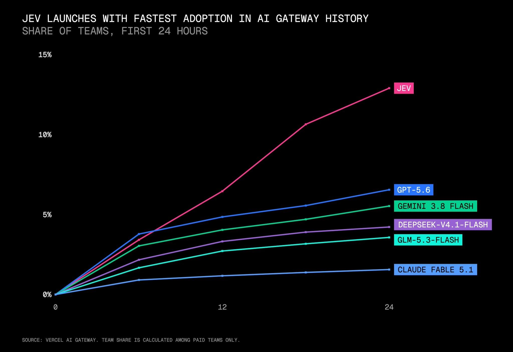
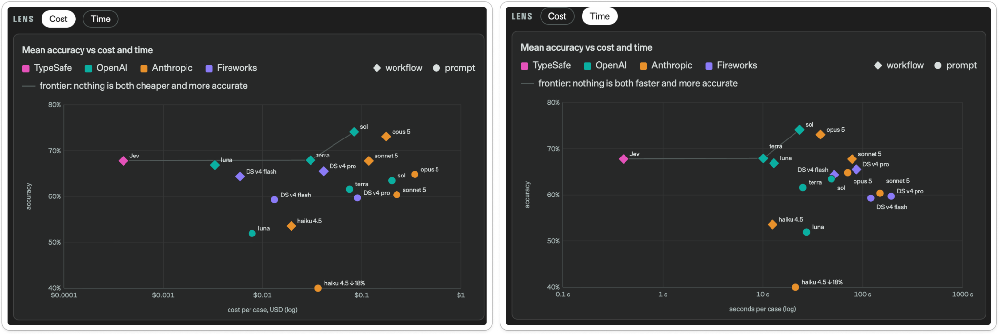
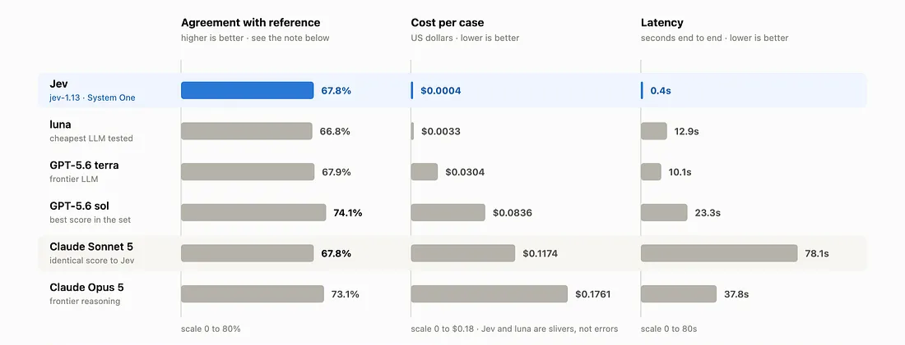

# What is Jev and why you should care about it for your AI-DLC

*Jev is a new AI model type from the family of “System One models.” It isn’t an LLM, but it created lots of waves. We researched what you should know and why it’s relevant for your company.*

> Originally published on [Jellyfish Research](https://jellyfishresearch.substack.com/p/what-is-jev-and-why-you-should-care) on 2026-10-06.

## **Introduction**

Agents are being implemented around the new SDLC: coding agents, verification loops and more. Some of these building blocks were made possible by the intelligence behind LLM models.

Recently a new family of models was released, defined as “System One model,” pioneered by TypeSafe with its new Jev release.

## **What Jev actually is**

Jev isn't an LLM; it's a System One model

The concept of a System One model comes from Kahneman’s idea that our brain has two systems to process information: System 1 is fast and intuitive; System 2 is slow and deliberate. Reasoning LLMs are System 2, Jev is System 1. It takes text as input describing a state, returns a score for a set of choices, selects the decision with the highest score, and validates the selection.

This is a significant contrast: getting a decision rather than open-ended text. Especially when trying to run software where the goal is to go from data to decisions. Jev’s speed, low cost and a different way of interacting with software present a new layer of intelligence that software organizations are eagerly experimenting with.

## **Methodology**

We identify Jev usage by tracking commits and PRs where the model was mentioned. We used this same methodology to track other AI models when they were launched.

This is a signal of exploration and interest in Jev. It’s not a measurement of adoption or usage of Jev — neither as a part of the SDLC (like Jellyfish measures the use of, say, Claude Code or CodeRabbit), nor as part of their products (e.g. as a model called by an in-app agent). Since this methodology has its limitations, these data points should be read directionally, as this is an early stage of a new model release.

## **Jev is spreading very fast…**

*Source: Internal Jellyfish Research, GitHub data as of 2026-09-25. Share of active companies with a PR or commit referencing each model in its first 30 days after launch.*

Since Jev’s release, the number of companies actively exploring with Jev so far has been growing and growing — though it’s worth noting that we can’t yet tell whether these models are being used for coding tasks or to build production systems. Still, this pace of exploration is worth analyzing.

*Source: Vercel AI Gateway report. Share of paid teams on Vercel’s AI Gateway that used each model within its first 24 hours after launch, so a different population and time window than the chart above.*

The adoption pattern we have seen for Jev in our data is also reflected in data from AI gateway applications, where the rate of uptake during the first 24 hours from its release surpassed every LLM,.

## **Jev is pushing the frontier of AI models, making AI fast and cheap**

The fast pace of exploration with this new technology isn’t a coincidence, considering the main value proposition. Jev excels at classification tasks, by being able to answer an order of magnitude faster than next best alternative, the Terra model family from OpenAI.

*Source: LENS benchmark. Mean accuracy vs. cost per case (left) and vs. latency per case (right), both on a log scale; the dashed line is the frontier, meaning no model is both cheaper (or faster) and more accurate than the models on it.*

## **Achieving the same performance at a fraction of the cost of other frontier models**

*Source: [Dev.community](https://dev.to/valyuai/how-to-use-jev-a-practical-guide-to-typesafes-system-one-model-g5e) benchmark , jev-1.13.Claude Sonnet 5 scores identically to Jev at roughly 300x the cost and 200x the latency.*

## **Why could Jev be relevant for the AI-DLC?**

Jev is an AI model that can complement LLMs in tasks where latency, cost, and decision-making matter. LLMs are still better for tasks that involve writing (e.g., code generation). Below, we detail the tasks well suited to Jev:

1. **Classification:**

   1. Flag risky code proposals from agents: When code is generated by an agent, a confidence score is attached to the output, and certain loops might retry if the score is subpar compared with the threshold. A model like Jev can be provided the code and asked to classify it as a FAIL or PASS, being faster and cheaper than an LLM.

2. **Routing:**

   1. Use it as the model in your orchestrator. Orchestration is a key part of making sure agents have the right set of tasks to execute in an autonomous manner. Today this is done with a workflow engine. The orchestrator controls the flow of what runs next, when to retry a loop, and when to stop. This has to be built upfront, which ends up acting as an IF/ELSE structure. Jev is exactly this without the need to define all the code upfront, offering a fast and scalable way forward.

3. **Verification:** Jev excels at running browsers and applications. This makes it extremely suitable for end-to-end tests in your AI-DLC, such as the following:

   1. **Browser tests:** Use Jev to run a browser to test a feature release in your app. Do QA, record a video, and save it so a human reviewer can watch it and approve the proposal.
   2. **Computer usage:** Track the full computer running the software implemented with no bugs. This takes longer, and using LLMs is token-intensive for most of the test. One of the key characteristics of Jev is how good it is at deciding, quickly, what needs to be done.
   3. **Jev-as-a-Judge for Evals:** Using Jev to judge traces, datasets, and experiments serves as a faster, more cost-effective alternative to repeated LLM-as-a-judge calls.

## **Conclusions**

We are still early in understanding the broader implications of Jev, and the wider class of new “System one” models, and how they will impact how software is built and reviewed. We believe more use cases will be unlocked in environments where cost and latency matter, which are increasingly critical to the software being built to create software.

## **Acknowledgements**

Thanks to Ben Kotrc and Nik Albarran for reviewing early drafts of this piece and pushing on the methodology and the use cases. This research is better because of them.
